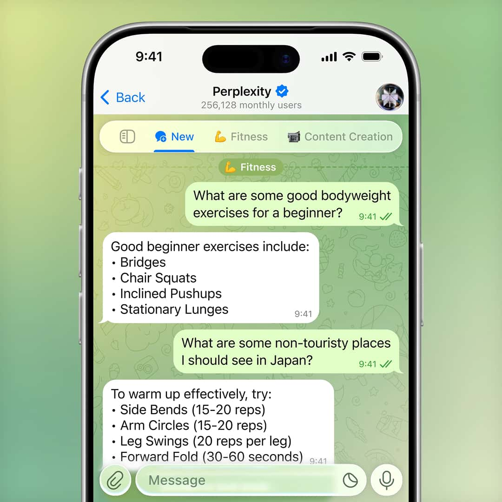

## Summary

Decision: a persona's chat gets a Telegram-style topics strip under its header: a list button, **New**, then one chip per open topic (a topic is one thread, with its own session and folder); Home keeps one row per persona, with a topic count.
Screens: the persona chat with its strip, New topic (with "Use a folder…"), the topic list (search, rename, archive), Home in both variants, and the Mac window. Each is drawn in Modern (dark and light), Terminal and Scene.
Approved (q1891, 2026-11-18) with its recommendations: Home keeps one row per persona; at most 6 chips before the rest fold into the list button.

`reference.jpeg` is the owner's screenshot (2026-11-17): a Perplexity bot chat with the list button, **New**, a chip
per topic, and a labelled divider where a topic starts.

## How these were made

This is a scratch package that depends on `apple/` by path and draws with CooeeUI's own `Look`, `Palette`, `ChatHeader`,
`ItemView`, `Composer`, `Avatar`, `Badge`, `ChatRow`, `PinnedRow`, `TopBar`, `HomeView` and `WorkflowChip`. Only the
new pieces (strip, chip, list rows, folder row, home row) are drawn here, under `Sources/Topics/`. It has no API
client and no app logic, and no app target links it. To render, run `swift test` in this folder. It writes every PNG
here: iPhone 17 at 402 × 874 pt, the Mac window at 1440 × 860 pt, both at 2×. Names are `<frame>-<style>-<mode>.png`.

## Frames and the decisions they show

| PNG | shows | answers |
|---|---|---|
| `chat-modern-dark.png`, `chat-modern-light.png`, `chat-terminal-dark.png`, `chat-scene-light.png` | Conductor in its **cooee queue** topic. Under the header comes the **strip**: the list button (`+2`: two open topics folded away), **New**, then a chip per open topic. The current chip is bold, with an underline in the link colour. A chip shows a folder glyph for a repo topic (`/` in Terminal) or a bubble for a scratch topic, then the title, then a cyan `…` while it works or a blue dot when it has unread messages. It scrolls sideways. Below it, Conductor's **Queue · Events · Workflow** chips get a row of their own. The transcript opens with a labelled divider naming the topic and its folder (`cooee queue · ~/src/cooee`), as Telegram's topic label does. | §1 the strip; §2 how a topic shows its folder; §5 plugins (two rows on iPhone) |
| `scrolled-modern-dark.png` | The same chat scrolled: the plugin row has scrolled away with the transcript, and the topics strip stays pinned. | §5 which row scrolls away |
| `press-modern-dark.png`, `press-terminal-light.png` | A long press on a chip (**herdsman release**) lifts it and opens **Rename · ~/src/herdsman · Archive**. Rename is #370's retitle. The folder line is shown read-only, because a topic's folder is fixed once it starts. | §2 retitle by long press |
| `new-modern-dark.png`, `new-modern-light.png`, `new-terminal-dark.png`, `new-scene-light.png` | **New** is selected: an empty transcript and a blank composer for the same persona. Right above the composer sits the folder row: **Use a folder…** (opens the folder picker), then the persona's recent repos (`cooee` picked, `herdsman`). With none picked, the topic gets a scratch folder. The first message sends, and its opening words (cut to 28 characters) become the chip's title. | §3 New and "Use a folder…"; §2 title from the first message |
| `list-modern-dark.png`, `list-modern-light.png`, `list-terminal-dark.png`, `list-scene-light.png` | The list button opens a sheet listing every topic of this persona: search, then **Open · 5** and **Archived · 2**. Each row shows the folder glyph, title, folder name, time, last line, and the unread badge or working mark (#370's rows). The second row is being renamed in place, and the fourth is swiped to **Rename · Archive**. **+** starts a new topic. | §4 the list |
| `home-persona-modern-dark.png`, `home-persona-modern-light.png`, `home-persona-terminal-dark.png`, `home-persona-scene-light.png` | **Home, one row per persona (recommended).** Conductor's row reads `5 topics` and names the topic a tap opens (**herdsman release**, which has unread messages), with the unread total of all its topics (3). | §6 variant A |
| `home-topic-modern-dark.png`, `home-topic-modern-light.png` | **Home, one row per topic.** Each Conductor topic is its own row (`Conductor  cooee queue`, `Conductor  herdsman release`, …), mixed in with other chats by time. | §6 variant B |
| `mac-modern-dark.png`, `mac-modern-light.png`, `mac-terminal-dark.png`, `mac-scene-light.png` | Mac (and iPad): the sidebar keeps one row per persona (variant A). The strip sits in the chat column as on iPhone, and the plugin chips share its row on the right because the window is wide enough. Neither scrolls away. | §7 Mac and iPad; §5 one row when wide |

## Decisions and recommendations

- **§5 Plugins:** two rows on iPhone (topics, then plugins). The plugins row scrolls away with the transcript and the
  topics row stays. On Mac and iPad, both share one row.
- **§6 Home: one row per persona (recommended).** Home stays a list of who you work with. The strip already does the
  switching once you're in the chat. One row per topic would let one busy persona push the others off the screen. The
  row shows the topic count and the summed unread count, and it names the topic a tap opens.
- **§7 Mac and iPad: the strip, not a second sidebar level.** The window's third column is already the persona panel
  (#236), and the same strip on every device means one component to build.
- **§8 Rooms get a strip; Others (persona-less chats) don't.** Rooms are long-lived and benefit from separate
  threads. An Other chat is already a one-off thread. Not drawn: a room's strip is this same strip under its header.
- **The header's `+` (New chat) goes away** wherever the strip shows, and the … panel's "New chat" becomes "New topic".
  That keeps one way to start a thread.

## The questions

- **Memory scope: no per-topic notes; `history` is enough.** Notes are the persona's durable memory (2,000
  characters), shared by every topic. Splitting them per topic would fragment that budget, and the agent would have
  to know which topic's notes to write. A topic's own context is its session. The new session's brief should carry the
  topic's title and folder. A topic that needs to recall an older one uses `history`. Build issue: check that
  `history` can scope to one thread, and add that if it can't.
- **Which topic a push opens:** the topic of the message it carries, always.
- **What the pinned avatar (and the Home row) opens:** the topic with the newest unread message; with nothing unread,
  the topic you last had open. This replaces #432's "newest" with "where the action is, else where you left off". So
  when the newest topic is not the one last read, you land on the one you were reading.
- **How many chips:** at most 6 open topics, most recently active first. The order is taken when the chat opens and
  never changes while it is on screen. The rest stay open but fold into the list button, which shows `+N`.
- **Blocks:** the strip is part of the native chat component, not a served block. It is navigation chrome. It needs
  instant switching, long press and sideways scroll, and its chips already change with data (the persona's threads),
  not with a release. The plugin row stays where #300 put it.

## For the build issues

- **Server** (not part of this design PR):
  - `GET /threads?persona=` must return each thread's title, folder, unread count, working state and archived flag.
  - Home needs a topic count per persona.
  - A thread's title is set from its first message (or by the client, then saved with `POST /threads/{id}/title`).
  - #370 adds archive and restore.
  - `history` may need a thread filter.
- **Order:** #370 (retitle, archive) first, then the strip and list, then the Home row and push routing.
- **No new package dependency.**
