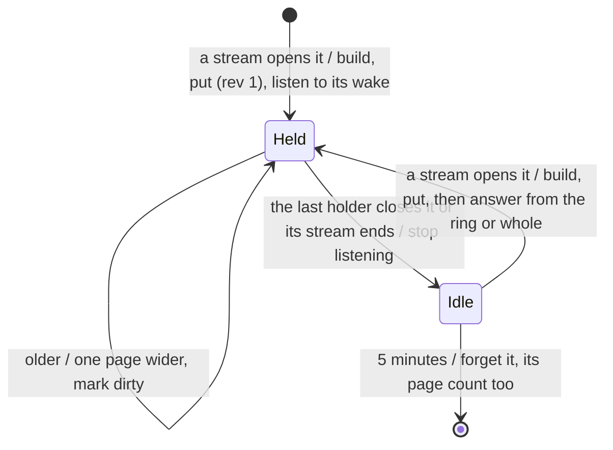
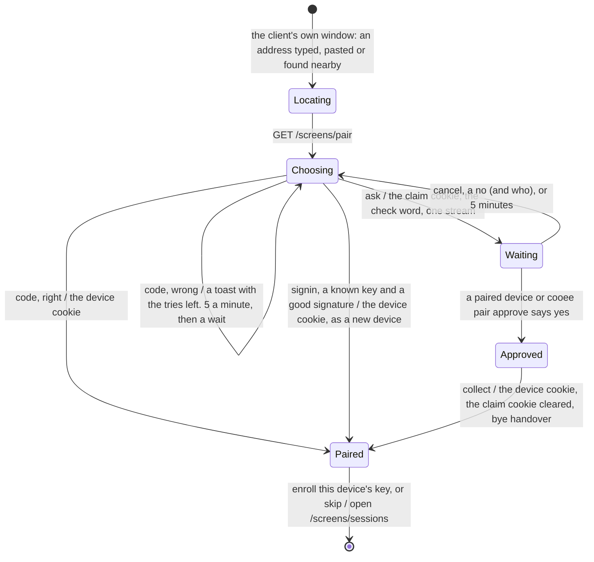

# Boundaries and statecharts (#714)

## Who may call whom

```
routes/stream.rs ──> live.rs ──> screens::source ──> screens/{chat,sessions,pair}.rs
   (HTTP only)       (Shelf, holders,   (generated)        │  build: state in, a Block out
                      pace, frames)                        │  act: an Action in, an Answer out
                         │                                 ▼
                         └──> hub (subscribe, home)    hub (read) · turns.rs · pairing.rs · Devices
routes/threads.rs ──> turns.rs ──> hub            routes/pairing.rs ──> pairing.rs ──> Devices
```

| Module | May call | May not |
|---|---|---|
| `live.rs` | blocks' `Shelf`, `Frame`, `Hello`, `Sync`; `screens::source`; the hub's `subscribe` and `home` | know a screen by name; build a block; change a thread |
| `routes/stream.rs` | `live.rs`, the gate's `Who` | hold a `Shelf`; read the hub |
| `screens/chat.rs`, `sessions.rs`, `pair.rs` | blocks' kinds; the hub's reads; `turns.rs`; `pairing.rs`; `live.more` | write an op, a frame or a rev; set a cookie anywhere but `pair.rs` |
| `turns.rs` (new: start, send, answer, moved out of `routes/threads.rs`) | the hub, `http.rs` | know HTTP bodies or blocks |
| `pairing.rs` | `Devices`; its own misses and challenges | |
| the hub, `cooee-core` | as today | know `live.rs`, a screen or a stream; `hub.rs` gains no line |
| `gate.rs` | `Devices` (`find`, `peek`) | let a claim reach anything but `/stream`, `/stream/{sid}` and the two open pair paths |

What holds each rule:

| Rule | Held by |
|---|---|
| Only `live.rs` publishes | the `Shelf` ban (`adr.md`, the arch.toml lines) |
| A device cookie is set only where a code, a claim or a key was checked | the `cookie(cx` ban |
| A route area is reached only through `routes::routes` | the `routes::` ban that exists; it is why the shared code moves to `turns.rs` and `pairing.rs` |
| A screen's GET and its stream agree | one `build` per screen, called by both; the test compares the mirror with `GET` |
| Both doors keep a message the same way | `routes/threads.rs` and `screens/chat.rs` call `turns::send`, neither calls `hub.send`; the send-once test runs through both |
| An unpaired stream reads one screen | `source(path, who)` answers `None` for `Who::Asking` on every screen but pair; its test |
| The lists stay generated | `scripts/gen.sh` writes `screens/mod.rs` (`routes`, `source`, `act`); `arch.toml`'s `generated` |

## A key on the server



- **Order.** One task per key builds and puts, so a key's revs count up by one and its frames leave in that order.
  Nothing orders two keys, or a sync's answer and the stream: a frame applies only on the rev it names (blocks'
  rule), so a client needs no other order.
- **Resume.** A client that comes back sends the rev it holds. Same epoch and still in the ring (16 frames or
  64 KB): the missed ops. Otherwise the whole screen. During a reply the ring is under a second, so a reconnect in
  the middle of one usually takes the screen whole: one answer of the 50-item window.
- **Idle.** A key nobody holds is not rebuilt. The first open builds it before answering, so the answer is never
  stale, and a turn that ran meanwhile costs one diff.

## A reply's text

```mermaid
stateDiagram-v2
    [*] --> Streaming: the turn's first text / a prose with streaming, last in the turn's message
    Streaming --> Streaming: more text / append: the added text, or the parts from the first changed one
    Streaming --> Streaming: a tool call / insert its tool before the prose; merge when its state changes
    Streaming --> Streaming: an owner or system item lands inside the turn / the prose moves whole to a new message
    Streaming --> Stored: the reply is stored / merge: streaming off
    Streaming --> Stored: cancelled, or the agent ended / the same, with what was written
    Stored --> [*]
```



The block keeps one id from its first character to the stored reply, so nothing already drawn is sent or drawn
again. The move in the fourth line is the one case that sends the text twice; it is right, only larger.

## Pairing on a desktop



Locating cannot be a server screen: the client has no server yet. A pasted pair link carries both the address and
the code, so the client opens `/screens/pair?code=` and the field is filled.
