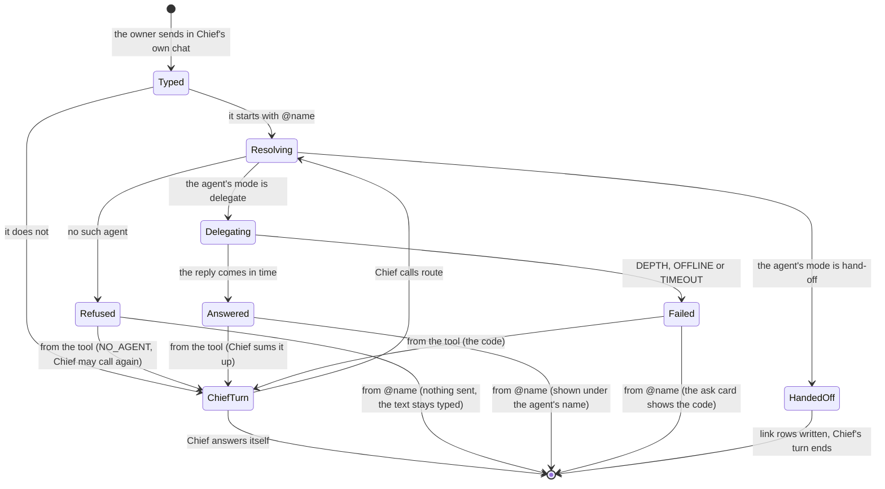
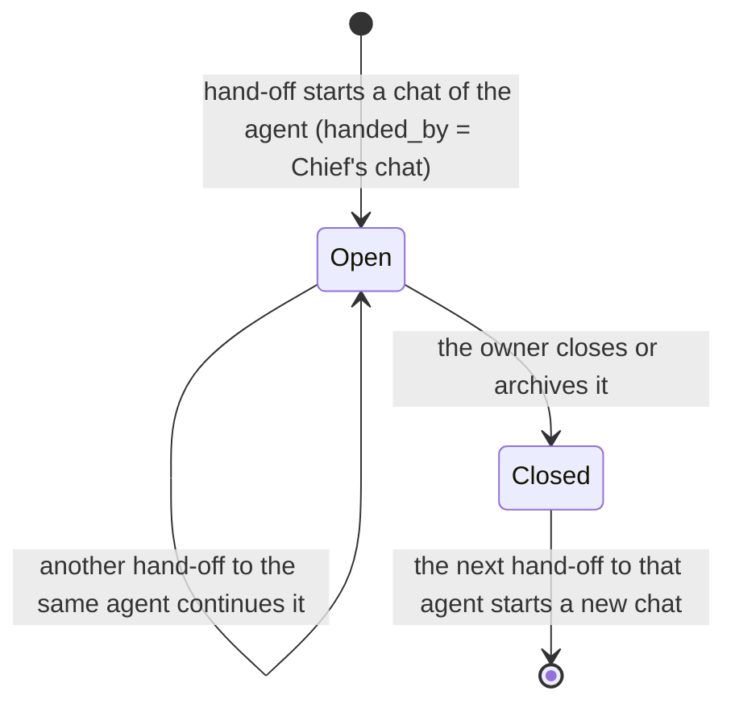
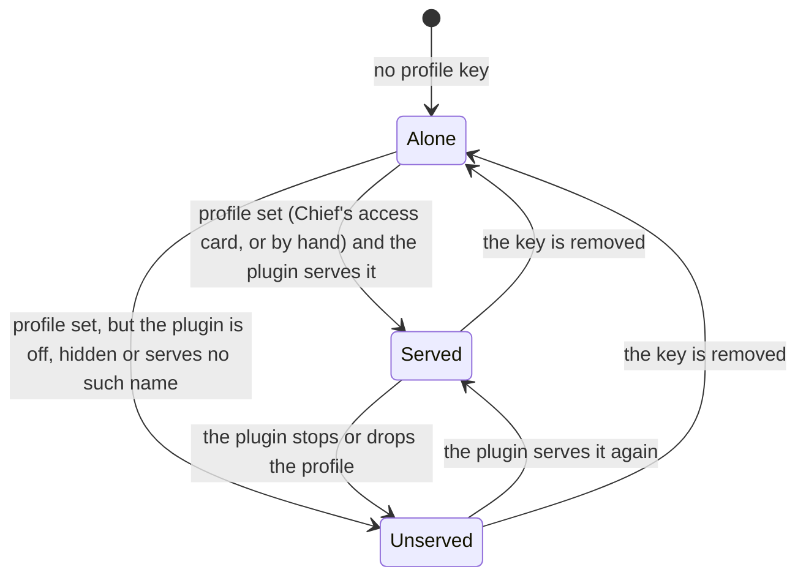

# Boundaries and statecharts: Chief's routing (#802)

## Which module may call which

| Module | Does | May call | May not |
|---|---|---|---|
| core `agents::route` (new) | `Purpose`, `Mode`, the table, the leading-mention reader | `agents` types | read a file, know the hub |
| core `profiles` | `Profile`'s two keys; `onto`, the one resolver of `profile` | `agents` | start anything |
| core `agents` | the three keys, their check, the plugin attach by `profile` | `route`, `profiles` | resolve a profile (it has no served list) |
| server `hub::route` (new) | `table`, `route`, `mentioned`, `handed`, the hand-off | `hub::ask` (the exchange), `hub::send`, `hub::rooms::seat`, `Hub::link`, core | `plugin::` (ban); `chief::` |
| server `hub::ask` | the exchange; `HAND_OFF` for a hand-off target | core `route::Mode` | `plugin::` (ban) |
| server `hub::send` | calls `mentioned` first in `send` and `queue` | `hub::route` | decide a mode itself |
| server `chief::tools::route` (new) | the tool: parse, `Hub::route`, the answer line | `Hub::route` only | `.send`, `.queue(`, `.approve(`, `plugin::` (bans) |
| server `http::recipe` | every start: `profiles::onto`, then the recipe with its backing plugin | core | start an agent whose profile is not served |
| server hub start (`create`, `start`, `create_later`) | reports a plugin-backed start: `thread-started` | `plugin::started` | |
| server `screens::chat` | `open` on a handed `send`; the message's name from `speaker` (as today) | `Hub::handed` | |
| the plugin pass-through (`routes/plugins`, `plugin.rs`) | unchanged: the only code that reads a plugin's blocks | the plugin's backend | change a byte of a screen |

Direction between the repos: cooee calls drover (`GET /cooee/profiles`, `GET /screens/cards` and its stream,
`POST /action`, `POST /cooee/thread-started`). Drover calls nothing of cooee's, and no route is added for it.

## What holds each rule

| Rule | Held by |
|---|---|
| The tool accepts only a real agent | `Hub::route` takes a `&Routable`, which only `Table::of` makes; the test for `NO_AGENT` |
| The model never picks the mode | the tool has no such argument; `match agent.mode()` in one place |
| No agent's words return from a hand-off | `Routed::HandedOff` has no text field |
| No one relays a hand-off agent | `ask_persona`'s `HAND_OFF`, tested with Chief and with a plain persona |
| `@name` calls no model for Chief | `mentioned` returns before `deliver`; the test reads the fake agent's log |
| Every route is labelled | the hub writes the `ask` or `link` row and the `speaker`; no tool can write an item (the #664 bans) |
| A plugin's blocks are never reworded | the `plugin::` ban on the routing files; the test compares bytes |
| One source for the Orchestrator's rulebook | `profiles::onto` reads the profile at each start; `check` refuses the profile's keys beside `profile`; the sample has no copy |
| A profile's guard is never skipped | `onto` returns an error for a profile not served or hidden; `recipe` has no fallback |
| Purposes cannot instruct Chief | one line, capped, the notes' refusal list |

## Statechart 1: one owner message in Chief's chat (delegate versus hand-off)

- In `Delegating` the owner may open the exchange and add a note; the asker gets it with the reply, as today.
- After `HandedOff`, any further `route` in the same turn is `HANDED_OFF`.
- From `@name` no state is `ChiefTurn`: Chief's session is not prompted. It is told of the exchange, in one line,
  ahead of its next turn.

## Statechart 2: a handed chat

## Statechart 3: an owner agent and its profile

- `Alone`: its own instructions and launch keys; mode `delegate` unless set.
- `Served`: starts with the profile's instructions, agent, settings and variables; mode and plugin attach are the
  profile's.
- `Unserved`: listed, but a start is refused with the reason. It is left out of Chief's tool list.
