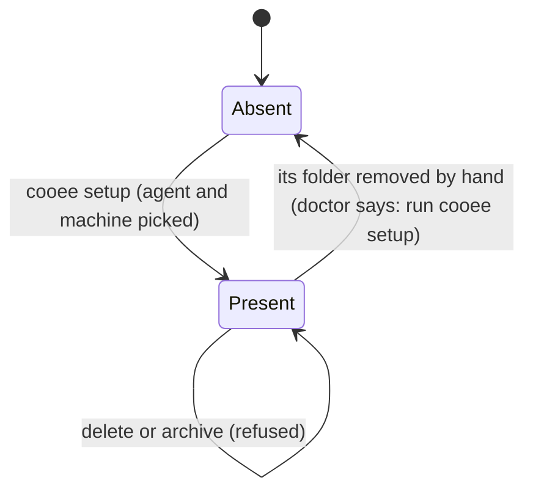
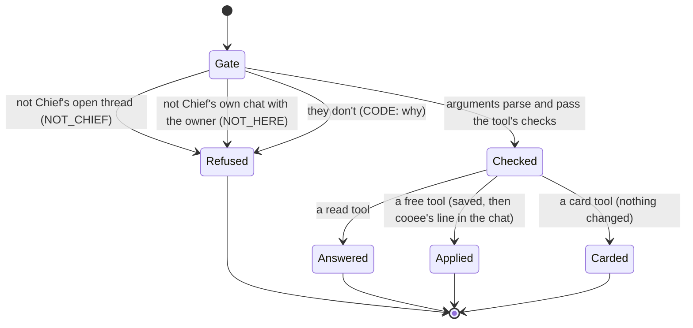

# Chief: module boundaries and statecharts (#664)

## Who calls whom

```text
 Chief's agent ─MCP─► cooee mcp serve --thread <id>      (mcp/own.rs: knows two paths, no tool names)
                         │ POST /mcp/agent/chief/tools, /mcp/agent/chief      Bearer: the thread's token
                         ▼
                      routes/chief.rs ──► chief.rs  list, call ──► hub.chief_of ─► Me   (the one gate)
                                             │
                                             ▼  chief/tools/<tool>.rs, one file a tool (the table is generated)
              ┌──────────────┬───────────────┼──────────────────┬─────────────────────┐
              ▼              ▼               ▼                  ▼                     ▼
      core chief, agents   Runner         Hub: say, scan,    http::save_persona    Hub::propose_change
      (create, archive,    (create_by,    create_room, mcp   (the phone's own       │  hub/chief.rs
       Carded, PersonaAsk)  edit)                             checks)               ▼
                                                                          a card in Chief's chat
 phone ─► POST /threads/<id>/approve {passkey} ─► Hub::approve ─► proposal_answer ─► Hub::apply_change
                                                                    (hub/chief.rs: mcp, secrets, agents, config file, machine)
 cooee setup ─► crates/cooee/src/setup/chief.rs ─► core chief::create
```

| Module | May call | Never |
|---|---|---|
| core `chief` (`chief.rs`, `routines/maker.rs`) | `agents`, `mcp`, `disk`, `config` types | sockets, processes, the clock, the keychain |
| server `chief.rs`, `chief/tools/*` | core `chief`; `Hub`'s `chief_of`, `propose_change`, `say`, `scan`, `mcp`, `create_room`; `Runner::create_by` and `edit`; `http::save_persona`; `machine::check` without `--yes` | `Live`, the store's files, shed, a write to `config.toml`, the keychain or a persona's launch keys; `Hub::send*`, `queue`, `approve` |
| `hub/chief.rs` | the hub's `raise`, `token_of`, `edit_mcp`, `queue` (Chief's own chat only); core `secrets`, `agents`, `disk`; `machine::check` with `--yes` | the `Runner`; any thread but the card's |
| `routes/chief.rs` | `chief::list`, `chief::call` | anything else |
| `mcp/own.rs` | the two paths | a Chief tool's name or schema |
| `routines/chief.rs` (`Runner::create_by`) | the book, `Hub::say` | cards (a GitHub or webhook routine goes through today's `create`) |
| `crates/cooee/src/setup/chief.rs` | core `chief`, shed's agents and links | the server |
| app `OwnerCheck.prove` (live) | Security framework, `Client`'s two passkey calls | any other server call |

## What holds each rule

| Rule | Held by |
|---|---|
| No other persona gets Chief's tools | Every tool's `run` takes `&Me`, and only `Hub::chief_of` makes one (thread open, token right, its persona is `chief` with role chief). `tools/list` asks the same gate. Test: another persona's list and call. |
| Chief's powers exist only in its own chat with the owner | The same `chief_of`: a thread another persona asked, a room member's session, a routine's run and a Workflow session get no `Me`, so no tool, no wider `history`, no wider `ask_persona`. There Chief is an ordinary persona. Test: an asked Chief, a routine's run. |
| The two widened tools stay narrow for everyone else | `ask_persona` skips `can_message`, and `history` takes `persona` or another persona's thread, only when `chief_of` gives a `Me`; else both are today's code. Both keep their depth and paging rules. Test: `tests/ask.rs`, `tests/history.rs`. |
| Exactly one Chief; delete refused | `agents::save`, `remove` and `load` (core): id `chief` ⇔ role chief. Test: the API's delete and a role sent on another id. |
| A carded change shows exactly what is applied | `Carded`'s constructors make the title, the detail and the `Change` from one checked value; `apply_change` takes the `Change` and nothing from the agent. A `version` refuses a file changed since. |
| Nothing carded applies without Face ID | `is_proposal` gains `change`: `POST /threads/<id>/approve` answers 403 without a valid passkey before the hub hears of it. `chief/tools/*` cannot write the config, the keychain or launch keys (table above): `agents::save` keeps a persona's launch keys from the file, as today, and `PersonaAsk` has no `machine` (unknown keys are refused). |
| Chief never acts as another persona | `.drover/arch.toml` bans `.approve(`, `.send` and `.queue(` under `chief.rs` and `chief/`; `ask_persona` is the only way to another persona and sends as Chief. Test: the tool list, by name. |
| Chief never sees a secret's value | `stored_secret set` raises today's secret card; the value goes from the card to `mcp::set_secret`. `look` lists names and redacts the config. |
| Persona texts are safe to save | `Hub::scan` (#350) on every Character and Instructions Chief writes. |
| A setup with no answer changes nothing | The `--yes` check is `Setup::run`'s first line. Test in `tests/setup.rs`. |

## Statecharts

Chief itself:



Any other persona:

```mermaid
stateDiagram-v2
    [*] --> Live: persona create (Chief) or the phone
    Live --> Live: persona edit
    Live --> Archived: persona archive (folder moved; its chats stay; its routines fail as a deleted persona's do)
    Archived --> Live: persona restore (refused when the id is taken)
    Live --> [*]: the owner deletes it (the phone; Chief has no delete)
```



A tool call:



A change card:

```mermaid
stateDiagram-v2
    [*] --> Open: propose_change
    Open --> Open: approve without a valid passkey (403)
    Open --> Declined: decline
    Open --> Applying: approve with Face ID
    Open --> RanOut: cooee restarted (the change was in memory, as every proposal's is)
    Applying --> Applied: saved; the card shows the line
    Applying --> Failed: the file changed since, or the check fails now; nothing written; the card shows why
    Declined --> [*]
    Applied --> [*]
    Failed --> [*]
    RanOut --> [*]
```



`Declined`, `Applied` and `Failed` each queue one cooee line into Chief's chat, so Chief knows without asking.
A tap on a card that ran out answers "ask the agent again", as today.
