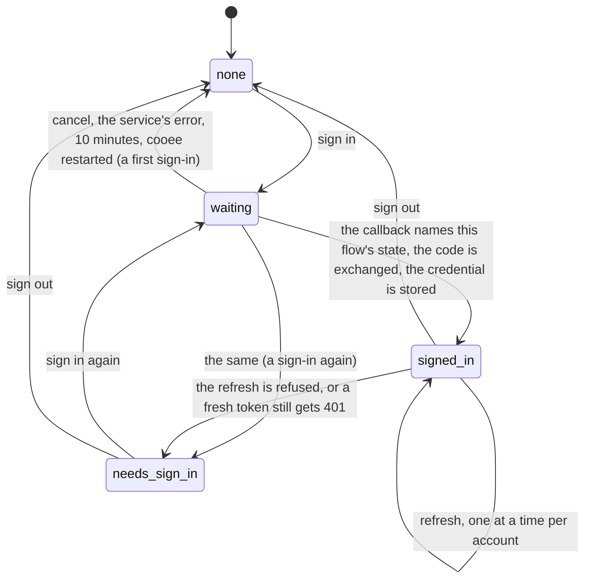
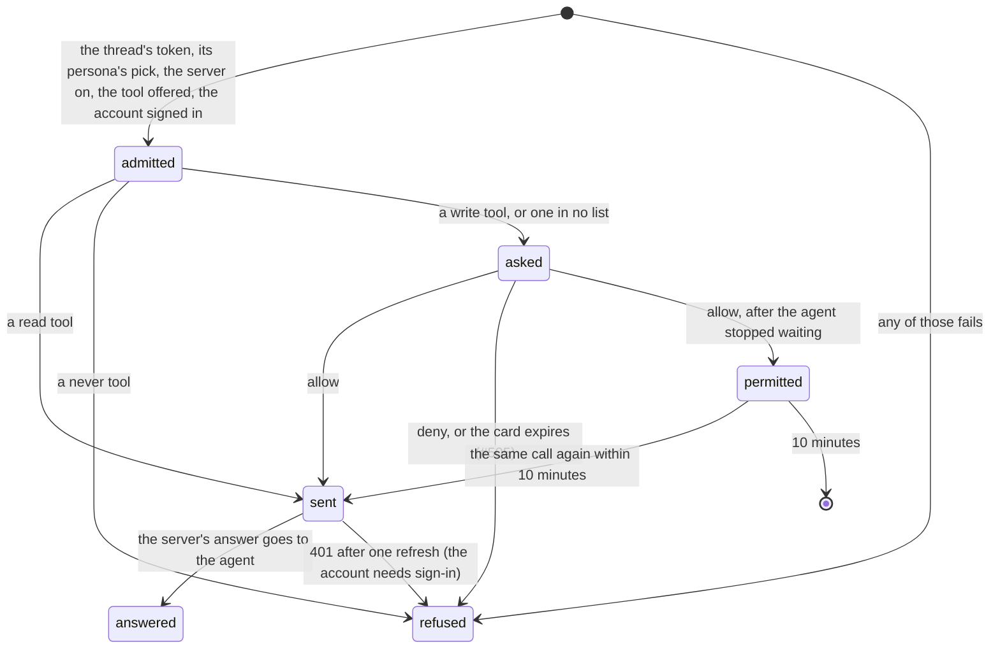

# Boundaries: who calls whom, the rules, the statecharts (#497)

## Modules

| Module | Holds | May call | Never |
|---|---|---|---|
| `connectors/*.toml` (repo root) | one reviewed entry per file | - | - |
| `cooee_core::connectors` (new) | `Entry`, `Tools`, `Class`, the embedded catalogue; the pure half of sign-in: the PKCE pair, the authorize URL, reading a server's metadata and its `WWW-Authenticate` | `mcp`'s types, `sha256`, `random` | the network, the keychain, the clock |
| `cooee_core::mcp` | `Server` and its `Source`, `Pick` with `account`, check and save | `connectors` (a `catalogue = true` names an entry) | - |
| `cooee_core::secrets` | plus `remove`; `names` skips dotted items | - | - |
| `cooee_server::net` (new) | the one `curl` call: `fetch` (a whole answer) and `stream` (lines as they come), config on stdin, no redirect followed | `runner` | being bypassed: push, the routines' catch-up and connectors all send through it |
| `cooee_server::connectors` (new) | `registry` (plan, add, remove, mark read), `flows` (sign-in), `tokens` (private: credentials, refresh, revoke), `upstream` (streamable HTTP, `sse`, built-ins), `calls` (`admit`, `decide`, the ask) | `net`, `cooee_core::{connectors, mcp, secrets, clock}`, and the hub's public `token_of`, `mcp`, `edit_mcp`, `ask_card` | the hub's fields, `shed` |
| `cooee_server::connectors::builtin` (slice F) | one file per built-in: its tools and its calls to the provider's API | `net`, `tokens` | a write call: no file has one |
| `routes/connectors.rs` (new) | the phone's API, the callback, `/mcp/agent/rpc` | `connectors` | `tokens` |
| `screens/connectors.rs` (new) | the Settings rows | `connectors`' views | `tokens` |
| `mcp` proxy (`mcp/proxy.rs` after hot-files slice 13) | a command's child, or the pipe | `/mcp/agent/grant`, `/mcp/agent/rpc` | `curl`, a URL, a credential |
| the hub | plus `ask_card`: a plain card (form `tool`) whose answer wakes the waiting call | - | `connectors`: the calls go one way, connectors to hub |
| Swift `CooeeAPI/Connectors.swift`, `CooeeFeatures` (`Connectors` and `WebSignIn` clients, the feature), `CooeeApp/Live/WebSignIn+Live.swift` | the calls of [callers 1 and 2](callers.md) | by the package's layer table | a code or a token: none reaches the app |

`hub.rs` and `config.rs` are not edited by any slice: connectors' state is its own value in the server's context
(as the routines' runner and the plugin manager are), and the new `[[mcp]]` keys belong to `mcp::Server`.

## Rules and what holds each

| Rule | Held by |
|---|---|
| A credential is read only where a request is sent | `tokens` is a private module of `connectors`; `Secret` has no `Debug`, `Display` or `Serialize`, so logging or returning one doesn't compile |
| No token in the config, a transcript or a log (the issue's acceptance) | slice D's test: the whole flow against a fake sign-in server and a fake MCP server, then a search of the data folder, the config, every stored thread and the captured log for each fake token: no hit. `Server::check` already refuses a token in `[[mcp]]` |
| A token goes only to its own server | `upstream` sends it to the entry's exact URL; `net` follows no redirect; an `sse` endpoint on another origin is refused |
| The agent can't reach a URL server past the gate | `/mcp/agent/grant` returns no URL or header for one (a test asks with a thread's token and searches the answer) |
| An entry is whole and unambiguous | a core test parses every embedded file: every key known, each tool in one list, `https` |
| The callback does nothing without its flow's `state` | a test: no `state`, an unknown one and a used one each get 400 and change no file |
| `curl` is started in one place | the three old copies are deleted in slice B; a `[[ban]]` on `command("curl")` outside `net.rs` ([ADR, last section](adr.md)) |
| Core stays free of the network | `cooee_core::connectors` has no `runner` call (reviewed; the functions take and return text) |

## An account (per connector and name)

`waiting` is the in-memory `Flow`; only `signed_in` and `needs_sign_in` are written. Sign out tries the service's
revoke call, then deletes the keychain item whatever that answered. `needs_sign_in` raises one card in the thread
that hit it and one push; the connector's tools are not offered until it ends, and the agent's session is told why
(the `instructions` of the answer to its `initialize`). A chat always starts.

## A tool call

`refused` is an answer to the agent that says why, never silence. `permitted` covers an agent whose own time limit
for a tool call is shorter than the owner's answer: the permit is for that thread, tool and arguments only.
