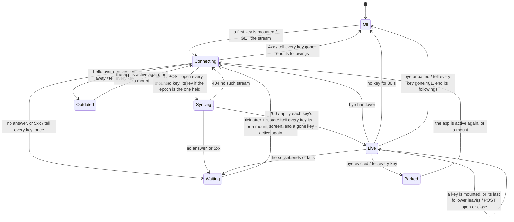
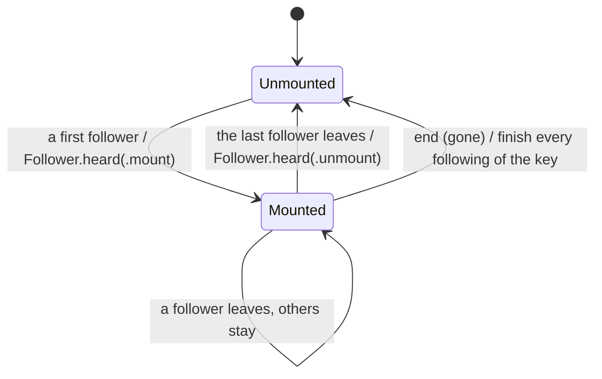

# device-stream: module boundaries and the statechart (#631)

## Who may call whom

| Module | Owns | May call | Must not |
|---|---|---|---|
| `Blocks` (the package) | the wire types, `Replica`, `Block.apply` | | |
| CooeeCore `Follower` | the `Replica`, the mounted keys, the link's state, decoding frames and replies | `Blocks` | read a clock, open a socket, know a URL |
| CooeeCore `LiveScreen` | the screen as last heard, its count, its key, `answered` | `Blocks` (`Block`, `Op`, `apply`) | parse an op itself |
| CooeeAPI `ScreenStream` | the socket, the POSTs, the waits, the followers of each key | `Client` (request, SSE framing, clock), `Follower` | import `Blocks`; decode a frame; decide a retry |
| CooeeAPI `ScreenStreams` | one `ScreenStream` per server and source | `Clients`, `ScreenStream` | |
| CooeeFeatures `PluginsClient` | `follow`, `act`, `screen` as a dependency | | |
| `ScreenFeature`, `ChatFeature` (chips, deck) | what is shown: `LiveScreen`s in reducer state | `PluginsClient`, `ScreenCache` | see an op, a rev, a `sid` or a socket; loop to reconnect |
| CooeeApp `PluginsClient+Live` | the wiring: `ScreenStreams`, the app's became-active signal | CooeeAPI | |
| cooee-server `routes/plugins.rs` | the two pass-through routes, the key check | `plugin::call`, `plugin::events`, blocks' `Sync` and `KeyState` | share a stream between devices; keep a rev, a screen or a `sid` |

The held screens inside `Follower` are the socket's bookkeeping, like an SSE stream's last id: what a view draws is
always a `LiveScreen` in a reducer's state, set by an action. The three bans in `adr.md` hold the Swift rows;
anti-slop's layer-imports holds the layers.

## The stream, per server and source

`Follower`'s link. `ScreenStream` carries out the steps; time enters only as `tick`.

- **A blip is silent.** `Live --> Waiting` tells no one. Followers hear `lost` only when the reconnect itself fails
  (`Connecting --> Waiting`), and `screen` again after the next sync, changed or not.
- **Frames before the reply.** No order is assumed between the stream and a POST's reply; `Replica` drops a frame at
  or below the rev held and takes a reply's ops only on the rev that was sent.
- **A gap or an unknown op** reopens one key. After a patch that did not fit, `Replica` holds no rev for it, so the
  reply is the whole screen.
- **Off keeps the `Replica`.** A stream opened again within the same epoch resumes by rev.
- **No key for 30 s** ends the stream from any state, not only from `Live`.
- **Outdated** sends no sync (`Replica.have` is empty). The banner asks for the update; the screens still load by GET.

## A key, in `ScreenStream`

## The server's routes

Stateless: a request in, the backend's answer out. The only rule of its own is the key check on `open`, the same
rule `GET /p/{plugin}/screens/{path}` applies to a path. A backend's `sid` is unguessable and every caller is a
paired device, so a `sid` is passed on as given.
