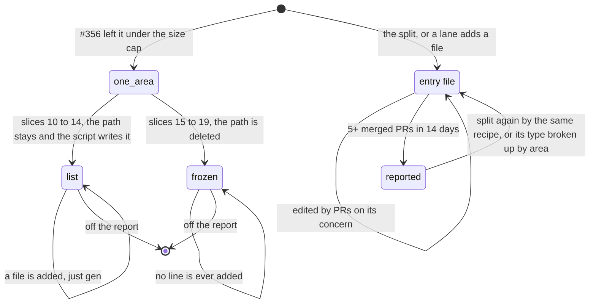

# ADR addendum: the 35 one-area files move too (#427)

## Summary

Decision: each of the 35 one-area files becomes a folder of files, one per concern. A Rust module keeps its path as the folder's list, written by the script; a test, Swift or doc file is deleted and its path frozen. All 35 leave the report.
Slices: 10 to 12 core modules, 13 and 14 server modules, 15 to 17 integration tests, 18 Swift files, 19 the themes doc; one serial PR each.
Open questions: four types every feature adds a field to (thread, config, chat summary, persona) stay one small file each and may be reported again: split them by area next, or wait for the next run (my pick)?

Adds to the approved ADR ([`adr.md`](adr.md), #356) and changes its decision 11 (q1697). Files: this addendum and
[`addendum-files.md`](addendum-files.md) (each of the 35 files: its folder, its entries, its slice; what the script
writes).

## How the code reads afterwards

Written first; the rest serves it. One rule for a lane: **a new thing is a new file, an edit goes to the thing's
file, and nobody edits a list.**

A new shed call. Today: a method added to the 530-line `impl Shed` in `shed.rs`. Afterwards: a method in the file
of its concern, or a new file with its own `impl` block.

```rust
// crates/cooee-core/src/shed/scrollback.rs (new)
//! A terminal's scrollback.

use serde_json::json;

use super::{Shed, ShedError};

impl Shed {
    /// Terminal `name`'s scrollback as plain text.
    pub fn scrollback(&self, name: &str) -> Result<String, ShedError> {
        Ok(self.call("terminal.scrollback", &json!({ "name": name }))?.to_string())
    }
}
```

`just gen` adds `mod scrollback;` to `shed.rs`. Callers do not change: `use cooee_core::Shed;` then
`shed.scrollback("t1")`.

A new type in an area is the same: `store/pin.rs` holds `pub struct Pin`, `just gen` re-exports it, and the crate
says `crate::store::Pin` as it says `crate::store::Thread` today.

A new integration test:

```rust
// crates/cooee/tests/chat/pinned.rs (new)
//! A pinned message stays on top.

use crate::{setup::setup, support::Events};

#[test]
fn a_pinned_message_stays_on_top_after_a_reconnect() {
    let s = setup();
    // …
}
```

`just gen` adds `mod pinned;` to `tests/chat/main.rs`. It runs as today: `cargo test -p cooee --test chat`.

A new SwiftUI view is a new file in its screen's folder (`apple/Sources/CooeeUI/Chat/PinnedBar.swift`); nothing to
run. A new section of the themes doc is a new file in `docs/themes/`.

## Question

The approved ADR left 35 files as they were: each already belongs to one area, so it got the 800-line size cap and
no new layout. They are 16 % of #356's predicted conflicts and 32 % of its update rounds. The owner decided (q1697)
that they move into the new layout too. What is "one file per entry" for a file that is not a list, and what takes
each of the 35 paths off the report for good?

## What the code and the log say

1. **Inside each file, PRs meet in one or two items.** Hunks of the merged PRs since 15 October: 56 of `shed.rs`'s
   land in `impl Shed`; 13 of `store.rs`'s in `struct Thread`; 24 of `config.rs`'s in `Config` and its defaults;
   `chat.rs`'s in `Summary` (10), `impl Chat` (10) and `Body` (6). The integration test files are lists already:
   100 tests in 11 files, which PRs append to.
2. **Only `frozen` and `generated` take a path off the report.** drover's hotspots drops the paths those two keys
   name (`hotspots.rs`, `arch::converted`); a `[[collect]]` folder alone does not. So each of the 35 paths must end
   as a generated file or as a deleted, frozen path.
3. **A big `impl` splits across files; a struct's fields do not.** Rust takes any number of `impl Shed` blocks, each
   in its own file. `Thread`'s fields must stay in one `struct`, so `store/thread.rs` stays a place where PRs meet.
4. **Checked in a scratch crate** (toolchain 1.99.1, the workspace's lints, `cargo clippy --all-targets -- -D
   warnings`, `cargo fmt --check`, `cargo test`, all exit 0):
   - a generated `chat.rs` of `mod` lines and `pub use <file>::*;` lines beside `chat/*.rs` builds, and callers'
     paths (`crate::chat::Chat`) do not change;
   - a `pub use` of a file with no `pub` item fails the build (`unused import`), so the script writes it only for a
     file that has one;
   - a field or helper that two files of a folder share must be `pub(super)`: the old file's privacy, no wider;
   - `tests/chat/main.rs` is found by cargo as the test target `chat`, as `tests/chat.rs` is today, and reaches the
     shared support with `#[path = "../support/mod.rs"] mod support;`;
   - `rustfmt` orders `use` lines differently from the C locale (`sign_in` before `sign2`), so the script pipes
     what it writes through `rustfmt`; a second run writes nothing.
5. **The line cap counts a file up to its first `#[cfg(test)]`.** Unit tests must stay at the end of the file whose
   code they test; a tests-only file would count as product code. Headroom today: 19,517 of 27,500 Rust lines,
   10,875 of 13,000 Swift lines.
6. **drover's `--refactor` gate** passes a PR whose test files (any path under a `tests/` folder) add exactly the
   lines they remove. Splitting a test file repeats its `use` lines, so the three test slices cannot carry the
   mark; the source and Swift slices can.
7. **`drover arch-check` with the final `.drover/arch.toml`** (the lines at the end) on staging's head (34c1f32):
   it parses, 0 violations, exit 0.

## Options

| | Shape | For | Against |
|---|---|---|---|
| A | As approved: the size cap only | No work | The owner decided against it (q1697): the 35 stay on the report |
| B | Freeze the 35 paths as they are | Off the report at once | A freeze forbids a new line: no bug in these modules could be fixed |
| C | A hand-written kernel per module (`chat.rs` keeps the types, `chat/*.rs` the operations), as `hub.rs` | Children read the kernel's private fields | The kernel is the hot part (finding 1: the types), and it is neither generated nor frozen, so the path stays on the report |
| D | **The path becomes the folder's generated list; every item moves to a file of its concern** | The listed path is generated, so off the report for good; new work lands in new or small files; callers do not change | Shared fields become `pub(super)`; a type every feature extends is still one file (finding 3) |
| E | D, and break `Thread`, `Config`, `Summary` and `Persona` into one part per area | Removes the last meeting points | Changes every caller of those fields, and the config file's keys cannot nest without changing the file format: not a move |

## Decision

**D.** Each of the 35 files becomes a folder; [`addendum-files.md`](addendum-files.md) names each folder and its
entries.

1. **An entry is one concern**: a type with what only it needs, or one group of operations as its own `impl` block
   of the folder's main type. The items move as they are. Three things may change in a moved line: a field or
   helper two files share becomes `pub(super)`; a file gains its own `use` lines and a `//!` line; a path inside
   `include_str!` gains a `../`.
2. **A Rust module keeps its path as the list.** `chat.rs` keeps its `//!` lines; below them the script writes one
   `mod` line per file of `chat/` and one `pub use <file>::*;` per file that has a `pub` item. Code outside the
   folder keeps saying `crate::chat::Chat`. What another module needs sits in a file with a `pub` item.
3. **Unit tests end the file whose code they test** (finding 5). A helper two files' tests share sits in a
   `#[cfg(test)] pub(super) mod` at the end of the file whose type it builds.
4. **A test target is a folder.** `tests/chat.rs` becomes `tests/chat/`: `setup.rs` (what every test of the target
   starts from), one file per scenario, and `main.rs`, which keeps the old file's `//!` lines and is otherwise
   generated. The existing tests move grouped by scenario; **a new test is a new file**. Target names and test
   names do not change. The old path is frozen.
5. **A Swift file becomes a folder of one type per file**, no list: SwiftPM and the Xcode project's synchronized
   folders compile it. The old path is frozen. `Fixtures.swift` goes to the `Fixtures/` folder that is there
   already.
6. **`docs/themes.md` becomes `docs/themes/`**: `README.md` (the introduction, and `## Today` once slice 5 gives it
   one) and one file per section. The old path is frozen; the comments and links that name it point at the folder.
7. **`scripts/gen.sh` gets two kinds**, `module` and `tests`, one input line per folder. It still writes only the
   files `generated` lists.
8. **The size cap stays** for every file. `push.rs` and `manage.rs` leave the baseline in slices 13 and 14.

## Consequences

- **All 35 paths leave the report when their slice merges**: 16 as generated files, 19 as frozen paths.
- **Not behaviour**: no type, route, command, test or doc sentence changes. What a person can see: a test's name
  in cargo's output gains its file (`reconnect::a_reconnect_…`), and the themes doc is a folder.
- **A new file can become hot.** `store/thread.rs`, `config/keys.rs`, `chat/summary.rs` and `personas/persona.rs`
  hold a type every feature adds a field to. They are small, so a conflict there is two lines, but five PRs in 14
  days put them on the report again. The fix for those is option E, an issue of its own (the open question).
- **Every open PR on a converted file needs one update round by hand**, as for slices 1 to 9. Slice 10 (chat,
  store, shed) is the widest: it should land when few PRs are open on those three.
- **Size**: about `src/ net +650` Rust lines over slices 10 to 14 (78 new files, each with a `//!` line and its
  own imports; 16 lists), against 7,983 of headroom. Swift: about +60 for imports.
- **The Swift cap count drops by about 120**: `scripts/line-cap.sh` already leaves out `Fixtures/` as design
  fixtures, and `Fixtures.swift` (121 lines) moves there. `apple_cap` does not change.
- **Slices 15 to 17 are not `--refactor`** (finding 6). Their proof is the list of tests: the same names, the same
  count, before and after (below).
- **A doc line that links a private item moves with the item** (`rooms.rs` links `PASS` and `TURNS` from its
  module doc): `cargo doc -D warnings` fails otherwise.
- **Three near-twins stay outside**: `FixtureItems.swift`, `FixtureRooms.swift` and `HomeRows.swift` are not among
  the 35 and are not moved. The same recipe takes them if they get hot.

## Who may call whom

| Rule | What holds it |
|---|---|
| Code outside a folder names what the list re-exports (`crate::chat::Chat`), never a file (`crate::chat::apply`) | the list declares each file as a private `mod` |
| A file uses a sibling's `pub` items through the list (`use super::Chat`) and its `pub(super)` helpers by file (`super::item::numbered`) | Rust privacy |
| The list is what the folder says | `generated`: arch-check reruns `scripts/gen.sh` |
| No line is added to a dissolved path | `frozen` |
| Unit tests end their file; no tests-only file in `src` | the line cap: `scripts/line-cap.sh` counts a tests-only file as product code |
| No file passes 800 lines | `[[size]]` |

Nothing changes between modules, crates or Swift layers: every folder sits where its file sat.

## A listed file's life, after this addendum

The approved chart's `area_file` state is gone:



## Slices

Each is one PR, queued `--serial` like slices 1 to 9: each edits `.drover/arch.toml`, and all but 18
`scripts/gen.sh`. The order follows the predicted conflicts within each family.

| # | Converts | Marks | Needs first |
|---|---|---|---|
| 10 | core: `chat.rs`, `store.rs`, `shed.rs` | `--serial --refactor` | - |
| 11 | core: `config.rs`, `login.rs`, `accounts.rs`, `devices.rs` | `--serial --refactor` | 10 (it adds the `module` kind) |
| 12 | core: `personas.rs`, `profiles.rs`, `plugins.rs` | `--serial --refactor` | 10 |
| 13 | server: `push.rs`, `login.rs`, `mcp.rs` | `--serial --refactor` | 10 |
| 14 | server: `manage.rs`, `plugin.rs`, `hub/rooms.rs` | `--serial --refactor` | 10, slice 2 (the hub) |
| 15 | tests: `chat`, `reliability`, `first_run`, `setup` | `--serial` | - |
| 16 | tests: `plugins`, `profiles`, `personas`, `mcp` | `--serial` | 15 (it adds the `tests` kind) |
| 17 | tests: `accounts`, `login`, `pairing` | `--serial` | 15 |
| 18 | Swift: `Item.swift`, `ItemsTests.swift`, `Chat.swift`, `Home.swift`, `Items.swift`, `Sheets.swift`, `Fixtures.swift` | `--serial --refactor` | - |
| 19 | `docs/themes.md` | `--serial` | slice 5 (the docs and the README's list) |

Every slice's proof, in its PR body: `just check` exit 0; `just gen` then `git status --short` empty;
`drover arch-check` exit 0; and the same tests before and after:

```sh
cargo test --workspace --locked --lib --bins --tests -- --list 2>/dev/null | grep ': test$' | sed 's/.*:://' | sort
```

gives the same lines at the base and at the head. Slice 18: `just apple-check` exit 0 and no snapshot changed.

## `.drover/arch.toml`

Each slice adds its lines in the PR that converts the files; `frozen` and `generated` are the arrays slices 0 and 1
made. A `[[collect]]` glob with `*/` covers every folder of its family, so slices 11, 12, 16 and 17 add none.

Slice 10: to `generated` `"crates/cooee-core/src/chat.rs"`, `"crates/cooee-core/src/store.rs"` and
`"crates/cooee-core/src/shed.rs"`; and

```toml
[[collect]]
dir = "crates/cooee-core/src"
glob = "*/*.rs"
```

Slice 11: to `generated` `"crates/cooee-core/src/config.rs"`, `"crates/cooee-core/src/login.rs"`,
`"crates/cooee-core/src/accounts.rs"` and `"crates/cooee-core/src/devices.rs"`.

Slice 12: to `generated` `"crates/cooee-core/src/personas.rs"`, `"crates/cooee-core/src/profiles.rs"` and
`"crates/cooee-core/src/plugins.rs"`.

Slice 13: to `generated` `"crates/cooee-server/src/push.rs"`, `"crates/cooee-server/src/login.rs"` and
`"crates/cooee-server/src/mcp.rs"`; `drover arch-check --write-baseline` (`push.rs` leaves it); and

```toml
[[collect]]
dir = "crates/cooee-server/src"
glob = "*/*.rs"
```

Slice 14: to `generated` `"crates/cooee-server/src/manage.rs"`, `"crates/cooee-server/src/plugin.rs"` and
`"crates/cooee-server/src/hub/rooms.rs"`; `drover arch-check --write-baseline` (`manage.rs` leaves it); and

```toml
[[collect]]
dir = "crates/cooee-server/src/hub/rooms"
glob = "*.rs"
```

Slice 15: to `frozen` `"crates/cooee/tests/chat.rs"`, `"crates/cooee/tests/reliability.rs"`,
`"crates/cooee/tests/first_run.rs"` and `"crates/cooee/tests/setup.rs"`; to `generated`
`"crates/cooee/tests/chat/main.rs"`, `"crates/cooee/tests/reliability/main.rs"`,
`"crates/cooee/tests/first_run/main.rs"` and `"crates/cooee/tests/setup/main.rs"`; and

```toml
[[collect]]
dir = "crates/cooee/tests"
glob = "*/*.rs"
```

Slice 16: to `frozen` `"crates/cooee/tests/plugins.rs"`, `"crates/cooee/tests/profiles.rs"`,
`"crates/cooee/tests/personas.rs"` and `"crates/cooee/tests/mcp.rs"`; to `generated`
`"crates/cooee/tests/plugins/main.rs"`, `"crates/cooee/tests/profiles/main.rs"`,
`"crates/cooee/tests/personas/main.rs"` and `"crates/cooee/tests/mcp/main.rs"`.

Slice 17: to `frozen` `"crates/cooee/tests/accounts.rs"`, `"crates/cooee/tests/login.rs"` and
`"crates/cooee/tests/pairing.rs"`; to `generated` `"crates/cooee/tests/accounts/main.rs"`,
`"crates/cooee/tests/login/main.rs"` and `"crates/cooee/tests/pairing/main.rs"`.

Slice 18: to `frozen` `"apple/Sources/CooeeCore/Item.swift"`, `"apple/Tests/CooeeCoreTests/ItemsTests.swift"`,
`"apple/Sources/CooeeUI/Chat.swift"`, `"apple/Sources/CooeeUI/Home.swift"`, `"apple/Sources/CooeeUI/Items.swift"`,
`"apple/Sources/CooeeUI/Sheets.swift"` and `"apple/Sources/CooeeUI/Fixtures.swift"`; and

```toml
[[collect]]
dir = "apple/Sources/CooeeCore"
glob = "*/*.swift"

[[collect]]
dir = "apple/Sources/CooeeUI"
glob = "*/*.swift"

[[collect]]
dir = "apple/Tests/CooeeCoreTests"
glob = "*/*.swift"
```

Slice 19: to `frozen` `"docs/themes.md"`; and

```toml
[[collect]]
dir = "docs/themes"
glob = "*.md"
```
