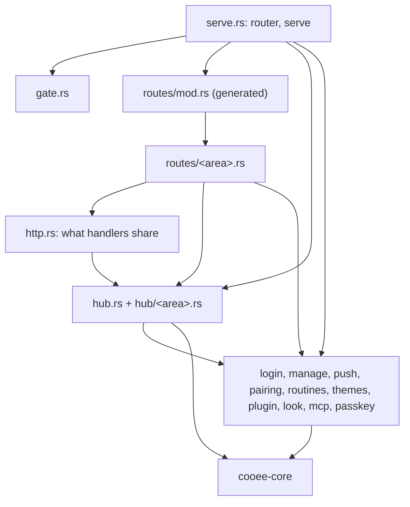
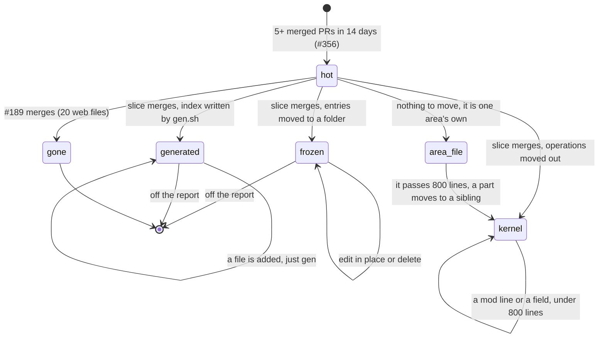
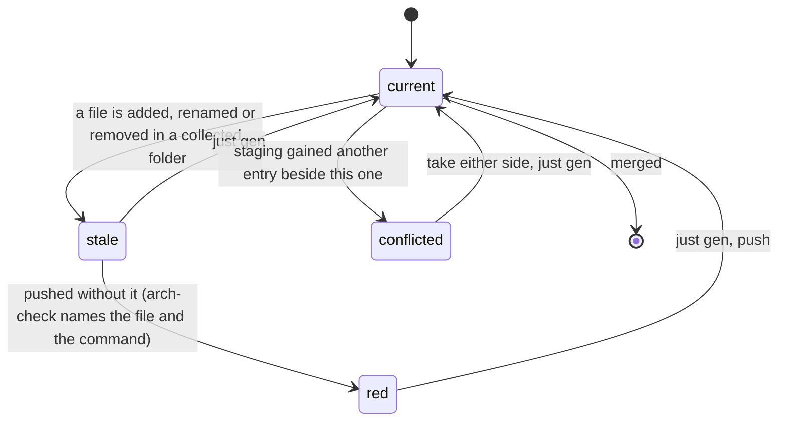

# Who may call whom, and the two statecharts

## The server crate

| Rule | What holds it |
|---|---|
| Only `serve.rs` calls `routes::routes`; nothing else names `routes::` | `[[ban]] pattern = "routes::"` (arch-check) |
| A route area does not call another area: what two need lives in `http.rs`, the hub or a service | an area's items are private; only `routes` is `pub(super)`; the ban above stops `crate::routes::…` |
| The hub and the services never call a route | the same ban |
| A hub area reaches another only through `Hub`'s methods; its `State` is private to its file | Rust privacy: `State`'s fields are not `pub` |
| `hub.rs` grows by a `mod` line or a state field, not by an operation | `[[size]] max_file_lines = 800` (arch-check) |
| `cooee-core` uses no workspace crate | `scripts/dep-direction.sh`, as today |
| No root name is added to a crate | `frozen` on `root.rs` (arch-check) |
| An index is what the folder says | `generated` (arch-check reruns `scripts/gen.sh`) |

## The CLI crate

`main.rs` → `cli.rs` (`Invocation`, `Command`, `Flag`, `Failed`) and `cmd::ALL` → `cmd/<word>.rs` → `cli.rs`, the
helper modules (`keychain.rs`), `cooee-core`, `cooee-server`. A command never calls another command:
`[[ban]] pattern = "cmd::"` holds it. What two commands share moves to a helper module beside `main.rs`.

## The native app

The layers do not change (Core → API → Features → UI → App, `apple/Package.swift`'s table, anti-slop
`layer-imports`). The new folders sit inside their layer: `CooeeCore/Models/`, `CooeeFeatures/Clients/`,
`CooeeApp/Live/`. A client's struct is in Features and its live value in App, as today; only the file each sits in
changes.

## Docs, CI and scripts

- `docs/<area>.md` links to other area docs freely; `docs/README.md` is the overview and names no endpoint.
- A gate script calls `scripts/` and the toolchain; no gate calls another gate.
- `scripts/gen.sh` reads only the collected folders and `Cargo.toml`s; it writes only the files `generated` lists.
- `apple/e2e/run.sh` is the one place that starts the server and the simulator; a step never does.

## A listed file's life

Each of the 80 files is in one of these states; a slice's merge is the only move, and arch-check refuses the way
back.

| State | Files | A hand edit | Checked by |
|---|---|---|---|
| generated | 5 indexes, `Cargo.lock`, the README's list | refused: rerun `scripts/gen.sh` | `generated` |
| frozen | 2 `root.rs`, `justfile`, 2 docs and 4 Swift paths that no longer exist | in place or a deletion; an inserted line is refused | `frozen` |
| kernel | `hub.rs`, `main.rs`, `ChatFeature.swift`, `Root.swift`, `ci.yml`, `apple.yml` | allowed, small | `[[size]]`, SwiftLint's 250 lines |
| area file | 35 one-area files | allowed | `[[size]]` on Rust, SwiftLint on Swift |
| manifest | 6 | allowed | cargo, SwiftPM, drover's hook on `ci/cap.toml` |

## A generated index during a PR

A stale Rust index also fails earlier and louder: the new file is not compiled, so its tests do not exist.
