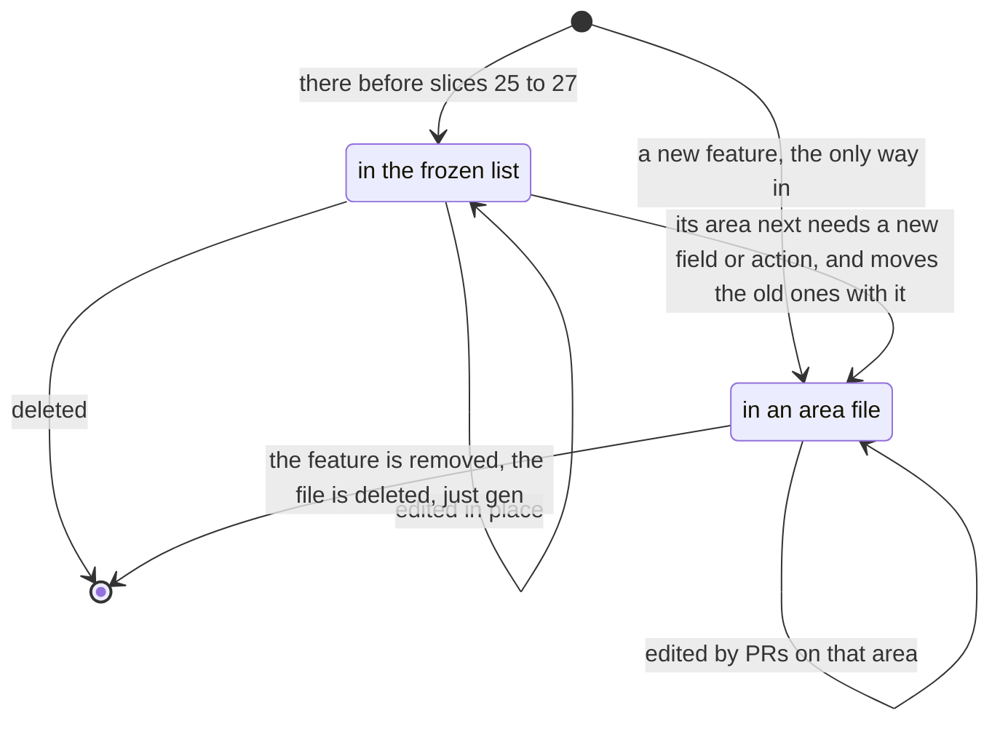
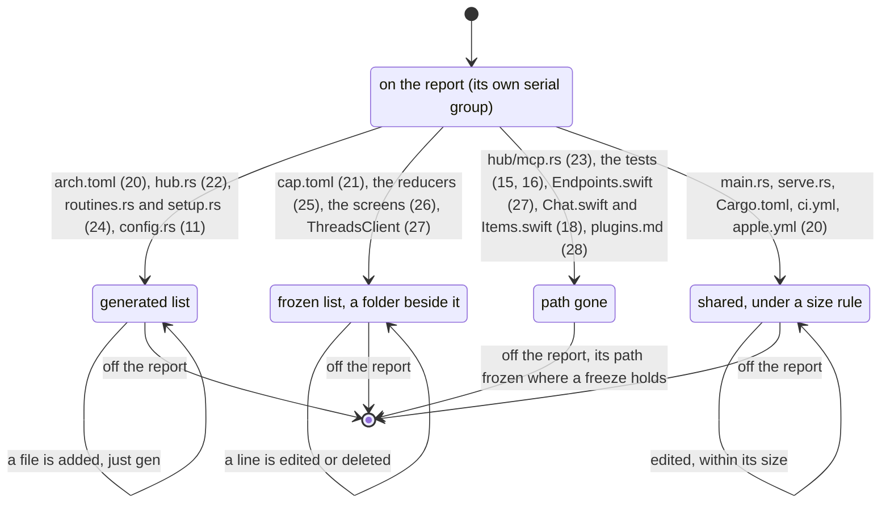

# Boundaries

Nothing changes between crates or between the Swift layers: every folder sits where its file sat, and
`apple/Package.swift`'s import table stands. What is new is who may touch a list.

## Who may call whom

| Rule | What holds it |
|---|---|
| `.drover/arch.toml` is what `.drover/arch/` says; nobody edits it | `generated`: arch-check reruns `scripts/gen.sh` |
| `hub.rs`, `hub/areas.rs`, the server's `routines.rs`, the CLI's `setup.rs` and the core's `config.rs` are what their folders say | `generated` |
| A hub area reaches its own state as `self.areas.<area>`; another area's only through a `pub(super)` field | Rust privacy: a `State`'s fields are private to its file |
| Code outside `hub/` names what `hub.rs` re-exports (`crate::hub::Recipe`), never a file | the list declares each file as a private `mod` (#427's rule) |
| `Hub::open` takes a `Seed`; an area reads its settings from `seed.config`, not from a new argument | `Areas::open(seed)` is the only caller of a `State`'s `open` |
| No field, action, dependency or reducer line is added to `ChatFeature.swift` or `AppFeature.swift` | `frozen`, with `CooeeFeatures/Chat/` and `App/` collected |
| A feature area is an `extension` of its feature: it sees the whole `State` and every `Action`, and takes its clients inside its function | the generated list calls `<area>(&state, action)`; the frozen list takes no `@Dependency` line |
| No sheet, task, modifier or actions line is added to `ChatScreen.swift` or `Root.swift`, no field to `ChatActions.swift` | `frozen`, with `CooeeUI/ChatScreen/` and `AppRoot/` collected |
| A screen area hands its views closures and values through its own environment key | `ChatActions.swift` is frozen |
| No closure is added to `ThreadsClient`; a new call is its area's client in `Clients/` with its value in `Live/` | `frozen`, at the two paths outside the collected folders |
| `CooeeAPI` stays the only layer with `URLSession` | anti-slop layer-imports, as today |
| A cap raise is a new file; the two values in `ci/cap.toml` do not move | `frozen`; drover's hook refuses a lane's edit to `ci/cap.toml` and `ci/cap.d/`, as today |
| A `shared` file does not grow past its rule | `[[size]]`: `Cargo.toml` 100, a workflow 200, a Swift file 300, a Rust file 800 |
| A generated Swift list is exempt from SwiftLint's length rules, and from nothing else | `apple/.swiftlint.yml` `excluded: *+Areas.swift` |

## An entry of a frozen list

The 44 chat fields, the 29 actions and the old clients' closures stay until their area needs a change.

There is no arrow into `old`: arch-check fails a PR that adds a line there.

## A listed file, in this run

## A generated list during a PR

As in #356 ([`../hot-files/boundaries.md`](../hot-files/boundaries.md)): add a file, run `just gen`, commit both.
On a conflict in a generated file take either side, run `just gen`, commit. That now covers `.drover/arch.toml`.
