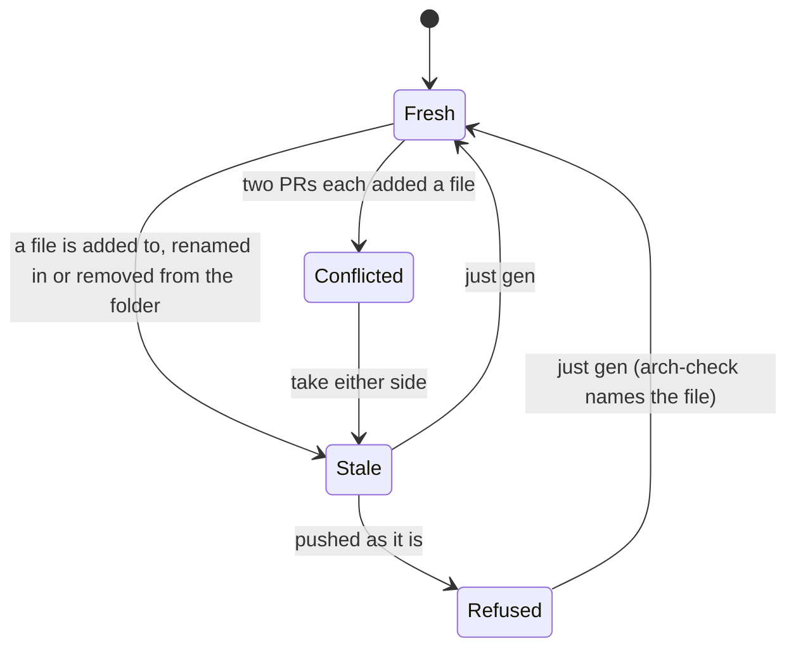

# Boundaries

Nothing changes between crates: every folder sits where its file sat, and `.drover/arch.toml`'s layers stand.
What is new is who may touch a list, and who may call whom inside the three new folders.

## Who may call whom

| Rule | What holds it |
|---|---|
| `scripts/gen.sh` loads the kinds and runs the inputs; it holds no kind and no step | `shared` under a 12-line `[[size]]` rule |
| A file of `scripts/gen/` defines functions and runs nothing when loaded; a kind may call `modules` and another kind | `just gen` then an empty `git status --short`, in each PR's proof: a file that ran on load would write without its input |
| A file of `scripts/gen.d/` calls kinds, one a line | as today |
| Only `scripts/gen.sh` loads `scripts/gen/`; `just gen` and arch-check's `generate` still run `scripts/gen.sh` | the `justfile` is frozen; `.drover/arch.toml` is generated |
| `agents.rs` is what `agents/` says | `generated`: arch-check reruns the script |
| Code outside `agents/` names `agents::<item>` or `agents::show::<item>`, never a file | the list declares each file a private `mod`, `show` alone `pub` |
| Only `home.rs` makes a `Home`; `save.rs` reads its folder through `Home::path` | `Home`'s field is private to its file |
| Only `save.rs` calls `Agent::over`; `list.rs` owns `parse` and `FILES`, `home.rs` owns `dir` | `pub(super)`: none of them leaves `agents/` |
| A file of `routes/threads/` shares nothing with a sibling: it reaches the hub through `crate::http` and a turn through `crate::turns` | its items are private; `routes` is its one `pub(super)` item |
| `routes/threads/` is reached only through `routes::routes` | the `routes::` ban, as today |
| `hub/tests.rs` holds helpers and no test | `shared` under a 120-line `[[size]]` rule |
| An area's tests reach another area through what it shows `pub(super)`, as its code does | Rust privacy |
| Tests that name a provider stay in a file named `tests.rs` | the provider bans' `tests.rs` exception, as today (no hub test names one) |

## A generated list

`agents.rs`, `routes/threads/mod.rs` and every list the script already writes move through the same states. The
lane's only move is `just gen`.

`Refused` is `drover arch-check`'s `generated` check, in CI and in `drover turn done`. `Conflicted` never needs a
hand merge: either side is a valid starting point, because the script rewrites the whole file.
