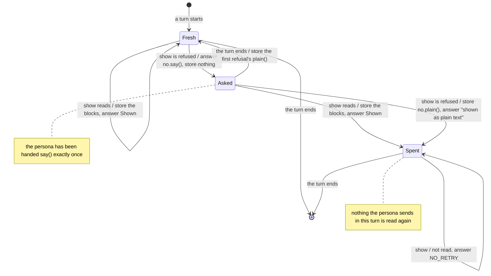
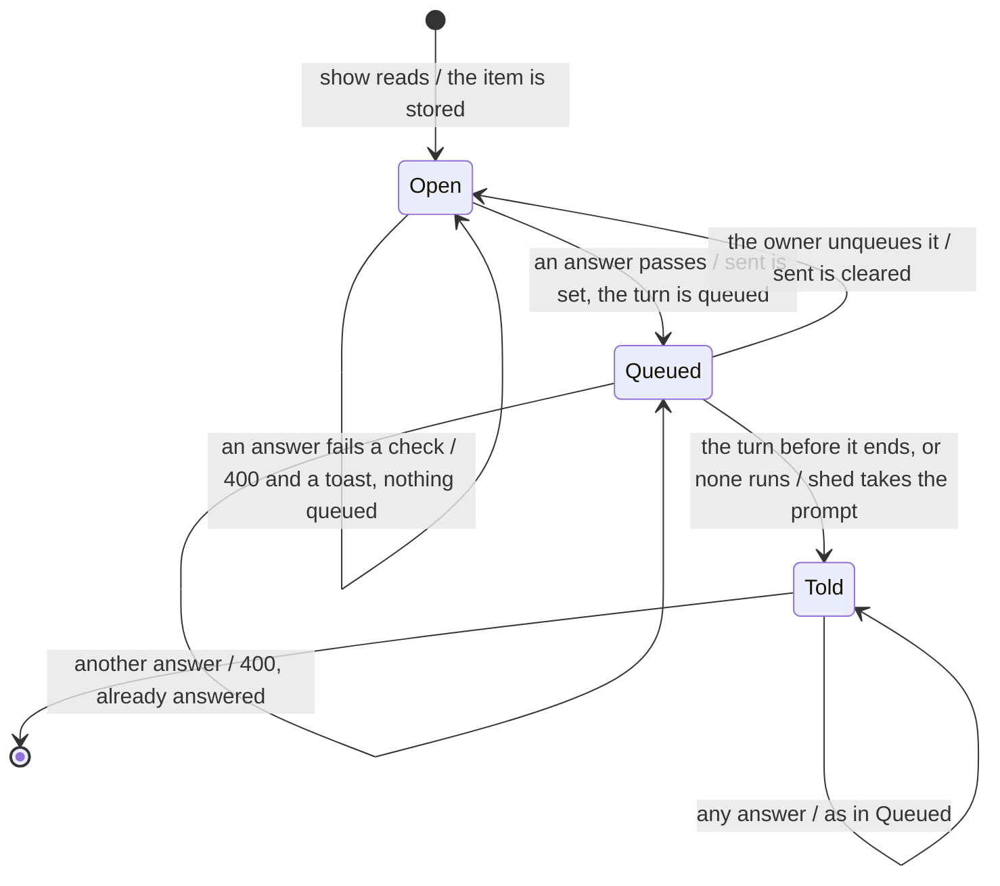

# Boundaries and statecharts (#776)

## Who may call whom

```
session start    hub/session ──▶ Agent::brief ──▶ show::brief ──▶ blocks model::prompt
                                 Agent::check ──▶ show::catalog

a reply          harness ─tool─▶ cooee mcp serve (mcp/own, mcp/tools/show) ─HTTP─▶ routes/mcp/show
                    ▲                                                                   │
                    └── say(), once ◀── Hub::show ──▶ Chat::show ──▶ show::read ──▶ blocks model::read

drawing          screens/chat ──▶ Body::Blocks (read only)        routes/threads ──▶ the same item as JSON

an answer        device ─POST /screens/action─▶ screens/chat::on ──▶ turns::Again::act ──▶ Hub::act
                                                 Hub::act ──▶ Chat::act ──▶ show::told ──▶ blocks model::own, Catalog::sends
                                                 Hub::act ──▶ Hub::enqueue ──▶ shed: the persona's next turn
```

| Module | Holds | May call | May not |
|---|---|---|---|
| `cooee-core` `show/` (new) | the two catalog files, `catalog`, `brief`, `Checked`, `read`, `plain`, `item_of`, `Sent`, `told` | blocks' `catalog` and `model` | a file, a clock, the hub; make a `Checked` any other way |
| `cooee-core` `chat/show.rs` (new) | `Shown`, the turn's `Tries`, `Chat::show`, `Chat::act` | `show/` | call `model::read` itself |
| `cooee-core` `agents.rs` | the `blocks` key, its check, the brief's part | `show::catalog`, `show::brief` | read a catalog file |
| `cooee-server` `hub/show.rs` (new) | `Hub::show`, `Hub::act`, `catalog_of` | the chat, `enqueue`, `token_of`, `agents::find` | call blocks' `model`; write a `Body::Blocks` |
| `routes/mcp/show.rs`, `mcp/tools/show.rs` (new) | the two routes; the tool's entry | `Hub::show`, `show::catalog` | read the reply |
| `screens/chat.rs` | drawing a `Blocks` item; sending a model-written block's action to `Again::act` | `Checked`'s blocks, `show::item_of` | match a model-written block's action by name; change a stored block |
| `turns.rs` | `Again::act`: restart a gone agent, then `Hub::act` | the hub | |
| blocks | the catalog's rules, the reader, the prompt, `own` | | know a persona, a thread or a turn |
| the harness and shed | the model call: provider, model, token limit, timeout, network retries | | |

What holds each rule:

| Rule | Held by |
|---|---|
| Nothing unread is stored or drawn | by type: `Body::Blocks` holds a `show::Checked`, whose field is private; the `model::read` ban keeps the one reader in `show/read.rs` (`adr.md`, the arch lines) |
| Only cooee's shipped files are catalogs | the `Catalog::read` ban outside `show/catalogs.rs`; the load test over the folder |
| A persona cannot change its own catalog | `update_persona` takes only Character and Instructions (today's type); Chief's change is a Face ID card, as for every key |
| One retry, never a third | `Tries` in `Chat`; the unit test that reads `Again, Plain, Spent`; the end-to-end test that counts the fake agent's calls |
| A model-written action never reaches the chat's own actions | `on` asks `show::item_of` before its `match`; the test that sends `archive` from a `b<n>.<m>` block and finds the thread open |
| An answer is checked before it is a turn | `Chat::act` is the only caller of `show::told` and the only writer of `sent`; `Hub::act` queues only what it returns |
| A reply takes one answer; a retried post is stored once | `sent` on the item; the queue's `random_id` rule, `act-<item>` |
| No catalog offers a secret or loads a file | the catalog test in `shapes.md` |
| The tool lists stay generated | `scripts/gen.sh` writes `mcp/tools/mod.rs` and `routes/mcp/mod.rs`; `arch.toml`'s `generated`, and `frozen` on the old lists |

`.drover/rules.md` is at its 30 lines. Nothing here adds one: each rule above is a type, a ban or a test.

## Statechart 1: a turn's `show` calls

The state is `Tries`, in `Chat`. It is the whole retry loop: blocks holds none, and the model call inside it is the
harness's.



- A turn ends when its reply is stored, when it is cancelled and when the session ends: `Chat::end`, as today.
- `Tries` is in memory. A server restart in the middle of a turn forgets an `Asked`: its plain text is not shown
  and the turn's next `show` counts as a first.
- A reply that reads with `cut` set cannot come from a tool call, whose arguments are whole JSON. If it does, the
  blocks that closed are stored: they are checked.

## Statechart 2: one blocks reply

The state is the item's `sent`, and the queue entry that names the item.



- `Queued` and `Told` draw alike: the blocks, then the line. Only the composer's queue tells them apart.
- A plain-text reply (`no.plain()`) is `Open` for ever: nothing in it sends.
- A catalog taken from the persona after the reply leaves it drawn and refuses its answer (`NotListed`).
