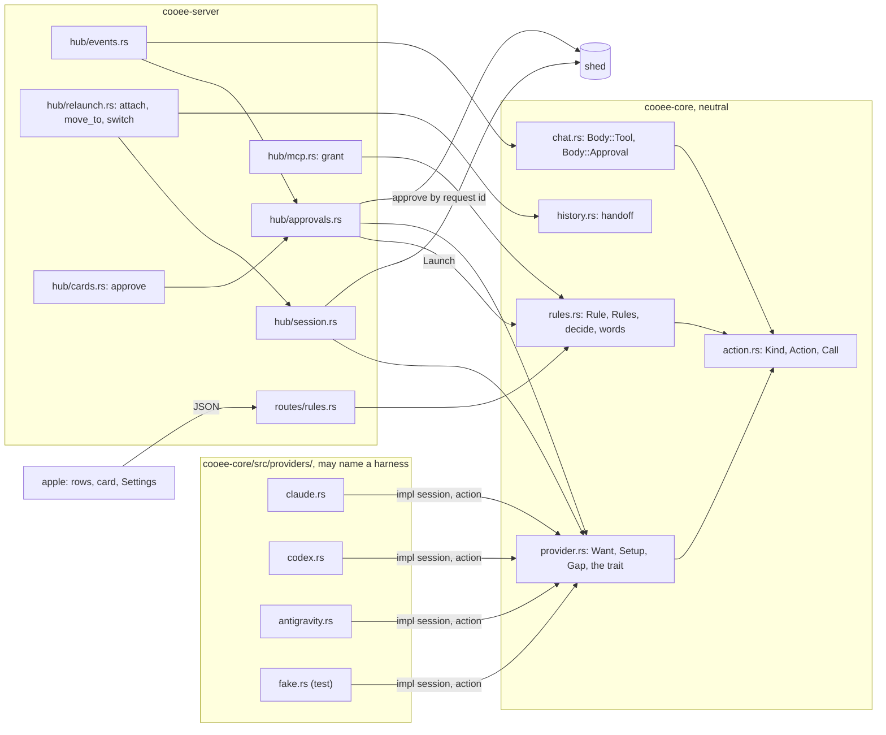
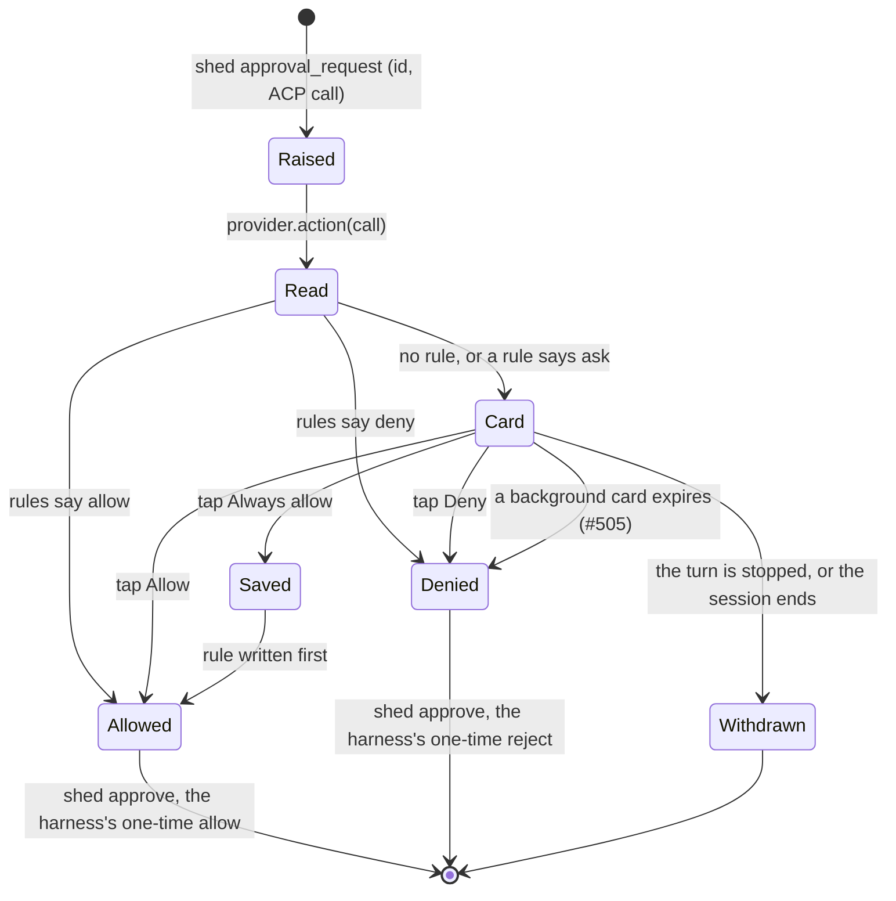

# Module boundaries and statecharts (#503)

## Who may call whom

| Module | May call | Never |
|---|---|---|
| `providers/<name>.rs` | `provider.rs`, `action.rs`, `login.rs`'s types (as #200) | `rules.rs`, the store, shed, another provider module |
| `rules.rs` | `action.rs`, `agents::Home`, `disk` (the surgical save) | a provider, shed, the hub; it never reads a harness's tool name |
| `action.rs` | nothing of cooee's | |
| `hub/session.rs` | `Provider::session`, `Logins::agent`, `Agent::brief`, `Agent::off` | be bypassed: no other module builds a persona's `Launch` or calls `session()` |
| `hub/approvals.rs` | `Provider::action`, `Rules`, `Shed::approve`, `Chat` | be bypassed: no other module calls `Shed::approve` (the arch.toml ban) |
| `hub/events.rs` | `approvals::asked` for an `approval_request`; `Chat::apply` with the provider's `action` | decide anything itself |
| `hub/mcp.rs` (`grant`) | `Rules::decide` for a deny | raise a card or wait for the owner |
| `routes/rules.rs` | `Rules::load`, `add`, `remove`, `Rule::parse`, `words` | build a rule's sentence anywhere else |
| apple, any client | the JSON: `action`, `title`, `words`, the card's three options | branch on a provider id or a tool's name; build a rule's sentence |

`scripts/neutral-core.sh` already fails a provider's name outside `providers/`. A harness's tool and setting names
live in the same folder by the first row; the conformance suite's steps are written in action kinds, so a name that
leaked into a client would draw nothing on the other harnesses.

## Statechart: one permission request

- Every answer names the request's id, so a second answer (a restart replaying events, two devices tapping) is
  refused by shed and changes nothing.
- After a restart cooee reads the events it missed: a request with no `approved` after it is decided again from the
  rules; a card already stored keeps its item and waits.
- `Saved` writes `rules.toml` before the answer goes out. If the write fails, the card stays open and says why.

## Statechart: a thread's session

```mermaid
stateDiagram-v2
  [*] --> Starting: first message (brief rendered, Setup built)
  Starting --> Unconnected: the start failed (kept; retry)
  Unconnected --> Starting: retry
  Starting --> Idle: ACP session ready
  Idle --> Working: a message (the brief first, when its channel is the first prompt)
  Working --> Asking: a card is open
  Asking --> Working: answered
  Working --> Idle: reply
  Working --> Limited: shed reports rate-limited (reset time, when the harness says one)
  Limited --> Working: a message after the reset
  Idle --> Hibernated: shed, after its idle time
  Hibernated --> Working: a message (shed loads the session with the same meta bytes)
  Idle --> Handoff: switch provider, attach or move
  Limited --> Handoff: switch provider
  Handoff --> Starting: new terminal, the new provider's Setup, handoff text kept for the next message
  Handoff --> Idle: the new start failed, so the old session is kept
  Idle --> Ended: closed, or the agent exited
  Ended --> [*]
```

- The brief belongs to the session: `Starting` renders it, nothing later touches it. A `Handoff` starts a new session,
  so it renders a fresh one.
- `Handoff` closes the old terminal only after the new one is ready, as `relaunch` does today.
- A switch is refused while `Working` or `Asking`: stop the turn first.
