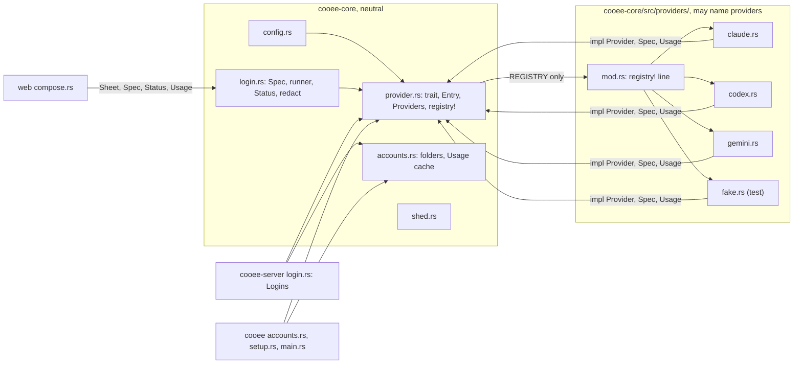
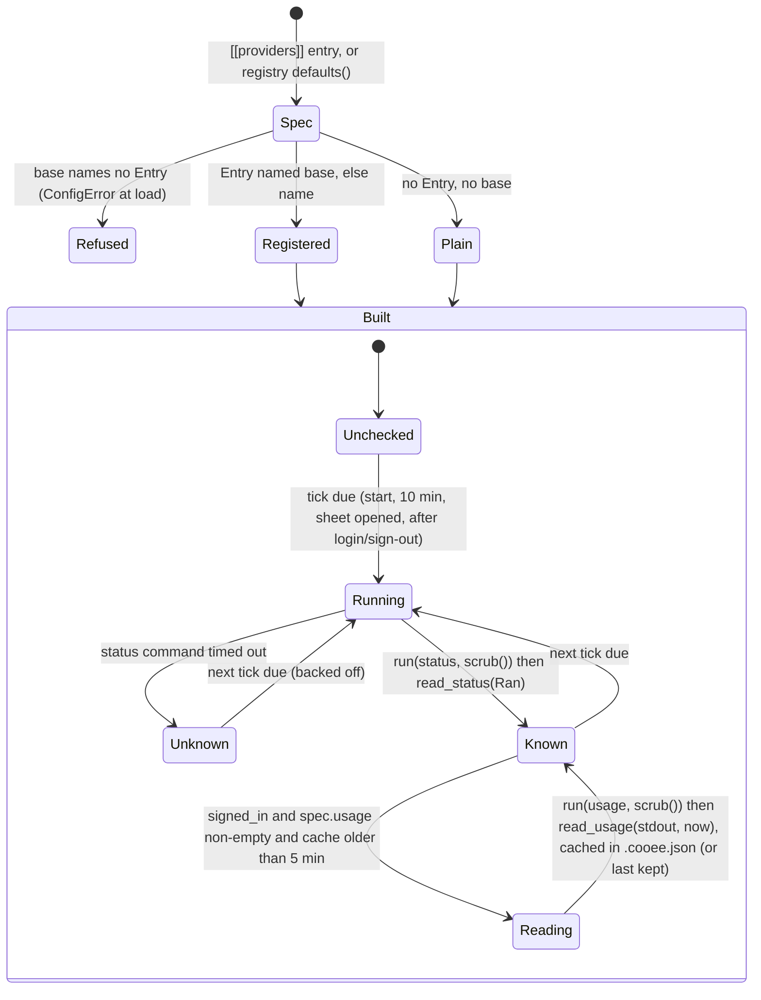

# Module boundaries, statechart and the neutral-core check (#200)

## Who may call whom

Rules:

1. Only `provider.rs` reads `providers::REGISTRY`, and only through `Providers::new`, `defaults()`, `agents_fix()`.
   `providers::*` modules are `pub(crate)`; nothing outside `cooee-core` can name `providers::claude`.
2. A provider module may use `provider.rs`, `login.rs` (`Spec`, `Ran`, `Status`, `one_line`) and `Usage`/`Window`;
   never `accounts.rs`, `shed.rs`, the store or another provider module.
3. `cooee-server`, `cooee` and `web` hold `Providers` / `Arc<dyn Provider>` / `Sheet` and call trait methods; they
   never compare a provider's `name` to a literal. (The neutral check makes such a literal fail CI.)
4. `web` never sees the trait: `Sheet.provider` stays a `Spec` clone; it shows `name`, `install` and `Status`.
5. Clients (web JS/TS, apple) get a provider as an opaque `id` and render it; no client branches on it.

## Statechart: a provider from config to a reading

Provider resolution happens once, at config load. The per-account check is today's (`Check` in
`cooee-server/src/login.rs`), shown only to place the hooks.

## The neutral-core check

`scripts/neutral-core.sh`, run by `just neutral` (in `just check`) and a `ci.yml` step after `hygiene`:

- Files: `git ls-files 'crates/*/src/**' 'web/src/**' 'web/ts/**'` minus `crates/cooee-core/src/providers/**`.
- In a `.rs` file, lines from its first `#[cfg(test)]` on are skipped.
- Fails, printing `file:line`, on `grep -inE 'claude|anthropic|codex|openai|gemini|hermes'`; else prints
  `core names no provider`.
- `ci/neutral-core-test.sh` (run by `just neutral` too) builds a fixture tree: a core file naming one fails; the same
  word under `providers/`, after `#[cfg(test)]`, or under `crates/x/tests/` passes.
- `.herdsman/rules.md` gains: "Don't name a provider (claude, anthropic, codex, openai, gemini, hermes) outside
  crates/cooee-core/src/providers/ and tests — scripts/neutral-core.sh".
