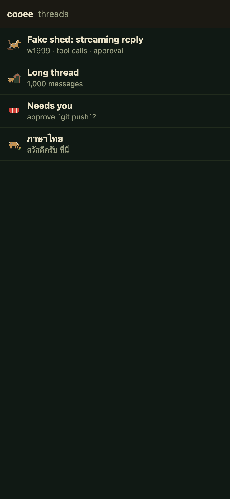
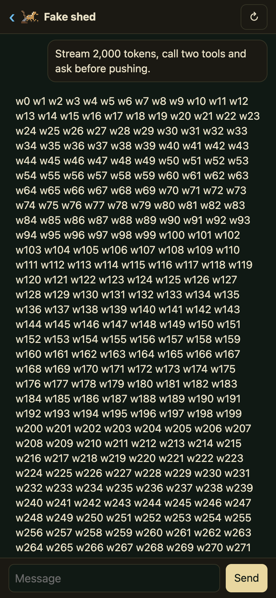
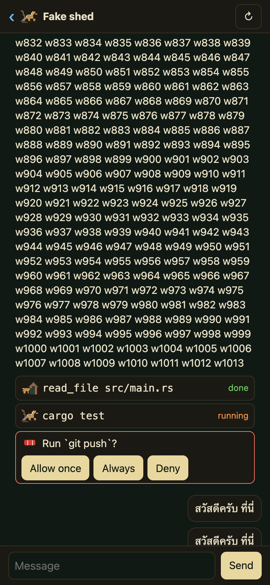
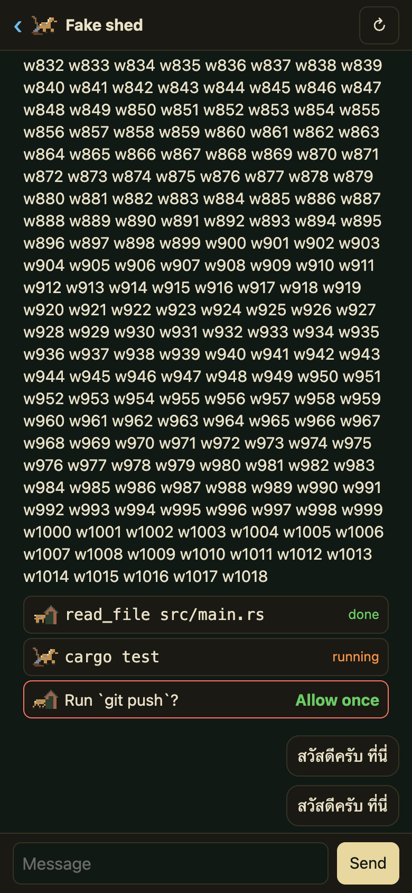
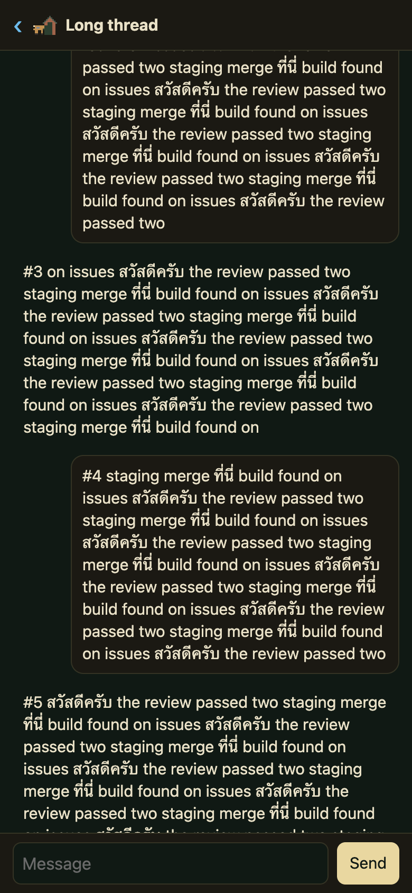
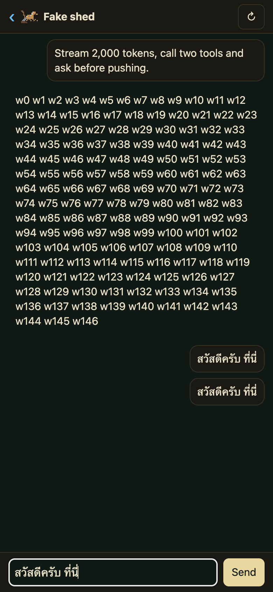

# 0001: UI framework, Topcoat or Solid (#10)

Status: proposed, 2026-11-05. Spike: `spikes/topcoat-chat/` (Topcoat `=0.11.0`, its own Cargo workspace, not production
code).

## Question

Can cooee's web UI be built with [Topcoat](https://github.com/tokio-rs/topcoat) (tokio-rs, MIT, pre-1.0)? The owner's
rule: spike Topcoat on the chat screen; go Topcoat if it passes the criteria below, else Solid (TypeScript).

## What was built

At 390 px, on herdsman's farm scheme and row sprites:

- `/`: the thread list, one animated row sprite per thread.
- `/live`: one thread fed by a fake shed (`src/shed.rs`): an in-process stream of ACP-like events (`text` chunks,
  `tool_call` status changes, `approval_request`, `reply`) at `RATE` tokens/s (50 by default) for `TOKENS` (2,000).
  The tool rows change status, the approval row has three option buttons, and there is a composer.
- `/long`: a thread of 1,000 messages (some Thai) and the composer.

How it uses Topcoat: pages are server-rendered by `view!`. The reply, the tool and approval rows, and the sent
messages are `live!` regions. After the first response the browser opens one WebSocket (`connected(cx)`), and the
server re-renders a region whenever the shed changes it. The approval buttons and Send are `#[procedure]` calls from
`$(…)` event handlers, and the composer is a signal. The server holds all the state; on reconnect the browser re-renders
every region from it.

## How it was measured

`spikes/topcoat-chat/measure/measure.mjs` drives Chrome for Testing 153 over the DevTools protocol (no npm dependencies).
It runs at 390 × 844 with 4× CPU throttle where the criterion says so, and records a Performance trace
(`devtools.timeline`). The reconnect test goes through a TCP proxy that resets every connection and refuses new ones for
10 s. Each token is numbered (`w0 … w1999`), so every render of the reply is checked to be an exact prefix of the
expected text: nothing dropped, duplicated or out of order.

The quoted numbers are three runs, `spikes/topcoat-chat/measure/results-run{1,2,3}.json`, on the shared Mac mini
(12 cores) while other lanes were compiling: load average 10 to 26 throughout, recorded in each file. Each run also
types into a page with nothing streaming (the *control*), so host noise can be told apart from Topcoat's cost.

Two measurement notes:

- **Headless Chrome** reports no frame presentation, so its Event Timing durations are garbage: 7–9 s for a key, with
  an idle main thread. The runs use a headful window.
- **Typing latency** is the trace's keydown → commit of the frame that shows the key: the main-thread work the page
  controls. Chrome's own input → presentation numbers (the Interactions track) are recorded too. In this window they
  read *higher with nothing streaming* (control p95 ≈ 600 ms) than while streaming (≈ 160–230 ms), because the display
  pipeline only presents promptly when something animates. They don't reflect the page, so they aren't used for the
  verdict.

## Criteria

| # | Criterion | Result | Evidence (runs 1 / 2 / 3) |
|---|---|---|---|
| 1 | **Streaming:** 2,000 tokens at 50 tokens/s, nothing dropped or duplicated; typing under 50 ms (4× throttle) | **Pass** | 2000/2000 tokens, final text exact, 0 bad renders in all 3 runs. Keydown → commit while streaming: p50 6 / 7 / 8 ms, **p95 19 / 51 / 26 ms**. Control with no stream: p95 30 / 60 / 119 ms. The stream never made typing slower than the idle page on the same host. Maxima over 50 ms (179 / 146 / 71 ms) also occur in the control (208 / 195 / 173 ms): they are host contention (load 10–26), not the page. An earlier run at lower load, before the reply was split into chunks (below): p95 18.9 ms, max 34.6 ms. |
| 2 | **Reconnect:** connection cut 10 s mid-stream, recovers with no lost or duplicated text | **Pass** | Cut at token 500 / 501 / 502; final text exact, 0 bad renders. Back 5.0 / 5.0 / 5.1 s after the network returned: Topcoat retries at 1, 2, 4, 8 … 30 s, so a longer cut waits up to 30 s. |
| 3 | **Long thread:** 1,000 messages scroll smoothly, no long tasks over 50 ms (4× throttle) | **Pass** | Touch scroll of 134,000 px top to bottom: 0 / 4 / 0 long tasks. Run 2's four (max 154 ms) came at load 22; runs 1 and 3 are clean. The 1,000 messages are plain server-rendered HTML, and no script runs while scrolling. |
| 4 | **Approval:** tap → server → row updated in under 300 ms on localhost | **Pass** | 5.8 / 7.8 / 7.5 ms from `click()` to the updated row painted (a procedure call, then the live region's re-render over the WebSocket). |
| 5 | **Thai input:** IME composition intact (“สวัสดีครับ ที่นี่”) in Chrome and Safari on macOS | **Chrome: pass. Safari (iPhone): pass, by the owner (q393)** | Chrome, while streaming: typed one code point per key with tone marks (as Thai Kedmanee types), and composed word by word through the IME (`Input.imeSetComposition`). The value is exact both ways, with one `compositionend` per word (none cut short), and the sent message is exact. Safari could not be driven: `safaridriver` needs “Allow remote automation” turned on in Safari, a host change this lane may not make. The owner typed it in Safari on the iPhone over the tailnet (command below), while streaming and after Send: “Ok the Thai words work nicely” (q393). Safari on macOS was not checked separately; it shares WebKit with iOS Safari. Risk below: Topcoat's `:value` binding sets the textarea's value on every input event. |
| 6 | **Theme:** the farm scheme and sprite render as in herdsman, theme files unchanged | **Pass** | `theme/` is herdsman's `assets/themes/farm/{theme.json,sprites.svg}` and `assets/schemes/farm.json`, byte-identical (`theme/SHA256SUMS`, `theme/SOURCE`). The scheme's tokens go on `:root` the way herdsman's server does it. Sprites are `<use href="#row-…">` with herdsman's `.rsp`/`.kf1`/`.kf2`/`kfr` rules, and the frames alternate (`--o1` read 1, 0, 0, 1 at 300 ms steps). Screenshots below. |
| 7 | **Cost** | (measured) | See below. |

### 7. Cost

- **Rust:** 398 lines (`src/main.rs` 281: pages, components, regions, procedures; `src/shed.rs` 117: the fake shed).
  CSS: 34 lines.
- **Hand-written JS shipped:** 1 line, `onsubmit="return false"` on the composer form. Everything else interactive is
  Rust in `$(…)`: the composer signal, Send, the approval buttons, ↻. Topcoat compiles it to JS inline in the HTML.
- **JS shipped to the browser:** Topcoat's runtime, 48.6 KB raw, **15.2 KB gzipped**, plus the compiled handlers inside
  the page (`/live` is 10 KB gzipped in all, including the 101 KB sprite sheet inlined as SVG).
- **Plain JS beside Topcoat's expressions:** only the form's submit guard. No `raw!` blocks were needed.
- **Tooling, not shipped:** about 260 lines of Node for the measurements.

### Streaming bandwidth (found on the way, not a criterion)

A `live!` region re-sends all of its markup on every emission. The first version (one region for the whole reply)
received **10.7 MB over the WebSocket for a 10.9 KB reply**, which grows with the square of the reply's length.
Splitting the reply into keyed 100-token chunks fixed most of that: each chunk is its own region and ends once sealed,
so only the last chunk streams. The same reply then costs **1.08 MB**, a tenth (`measure/wsbytes.mjs`), and every
criterion above was measured on this version. Header overhead (about 500 B a frame) remains; batching emissions, e.g.
10 a second, would cut it further.

## Screenshots (390 px)

| Threads | Streaming | Approval | Approved |
|---|---|---|---|
|  |  |  |  |

| Long thread | Thai in the composer |
|---|---|
|  |  |

## Verdict

**Topcoat.** Every criterion passes. The Safari half of the Thai input (criterion 5) passed in the owner's check on
the iPhone (q393: “Intact: Topcoat is the framework”).

The owner's check, on the tailnet:

```sh
cd spikes/topcoat-chat && PORT=8390 HOST=$(tailscale ip -4) ./run.sh
# then open http://<that ip>:8390/live in Safari (macOS) and on the iPhone; type “สวัสดีครับ ที่นี่” while it streams
# (↻ restarts the stream), then Send
```

## Risks

- **Pre-1.0 churn.** 0.11; the README says “early-stage and experimental”, and the runtime docs say “highly
  experimental”. Pin the exact version (as here) and budget for breaking upgrades. One trap seen already: an
  unsuffixed integer literal in `$(…)` is a `usize`, so `bump(1)` didn't compile against a `u64` argument.
- **`:value` and IME.** The binding writes `textarea.value` on every signal change, even an unchanged one
  (`topcoat-runtime` `browser/src/dom/binding.ts`). Chrome kept the composition intact; Safari and iOS are the known
  risk. The fallback is the same composer without `:value`: `@input` only writes the signal, and one line of plain JS
  clears it after Send.
- **Silent connection loss.** The WebSocket has no heartbeat. A reset connection reconnects (criterion 2), but a phone
  that sleeps or changes network can keep a dead socket open until TCP gives up. cooee would add a ping or a
  `visibilitychange` reconnect: a few lines, outside Topcoat today.
- **Reconnect backoff** doubles from 1 s up to 30 s and isn't configurable. It was 5 s after a 10 s cut, and could be
  up to 30 s after a long one.
- **Server-held state.** Regions re-render from the server's state on every reconnect. That makes reconnects exact, but
  cooee's server must keep each thread's live state (it will anyway, for shed's ACP sessions). Each connected region
  holds a task and a broadcast receiver; the default limit is 64 regions per tab.
- **Async runtime.** Topcoat is Tokio (it is tokio-rs), the same as shed's ACP client would use, so it doesn't conflict.
  Its server owns `main` through `topcoat::start` or `serve`.
- **Tauri loading from the server URL.** Topcoat renders on the server, and its static export is only on the roadmap.
  So a Tauri shell can't bundle the UI; it loads the cooee server's URL: remote content in the webview, Tauri
  capabilities scoped to that origin, and no UI while the server is unreachable. That suits cooee's model (the phone
  always reaches the server over Tailscale), but it rules out an offline-first desktop app.
- **Asset pipeline.** The runtime script reaches the page through Topcoat's CLI bundler (`topcoat asset bundle`, a
  separate `topcoat-cli` install, pinned in `run.sh`), so it is one more build step for CI and packaging.
